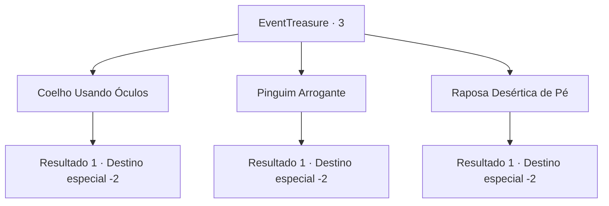

# Eventos de tesouro · 3

[Índice da tabela](index.md) · [Índice geral](../index.md)

ID: `pt:EventTreasure:3` · Fonte: `EventTreasure4` · Versão: 1.2.47.

Mapeamento estático dos arquivos; a disponibilidade e a execução dependem do estado da run.

## Texto do evento

*Sem texto no arquivo.*

## Dados de entrada

```json
{
  "id": 3,
  "grade": 1,
  "place": "",
  "required": ""
}
```

## Mapa das escolhas



## Escolhas e resultados

### Escolha 1

Coelho Usando Óculos

Requisitos e outros campos da escolha:

```json
{
  "required": ""
}
```

#### Resultado 1.1

Você escolhe o padrão de um coelho usando óculos. 

 "Você escolheu... errado."

 O homem que balança desaparece após dizer essas palavras. A lápide emite uma luz brilhante e, em seguida, se desintegra em pó.

Continuação registrada: [Destino especial `-2`](../destinos-especiais.md).

```json
{
  "required": "",
  "chance": "1",
  "nextEvent": -2,
  "type": 2,
  "reward": "5_40_9|0_2_1"
}
```

### Escolha 2

Pinguim Arrogante

Requisitos e outros campos da escolha:

```json
{
  "required": ""
}
```

#### Resultado 2.1

Você escolhe o padrão de um penguim arrogante. 

 "Infelizmente, você está errado."

 A lápide emite uma luz intensa, e então vira pó.

Continuação registrada: [Destino especial `-2`](../destinos-especiais.md).

```json
{
  "required": "",
  "chance": "1",
  "nextEvent": -2,
  "type": 2,
  "reward": "5_40_9|0_2_1"
}
```

### Escolha 3

Raposa Desértica de Pé

Requisitos e outros campos da escolha:

```json
{
  "required": ""
}
```

#### Resultado 3.1

Você escolhe o padrão da raposa desértica de pé. Ele sorri e fala. 

 "Você está...Correto."

 Ele desaparece enquanto a lápide brilha intensamente, e então algo flui através de você. Após a lápide perder o brilho, ela vira pó.

Continuação registrada: [Destino especial `-2`](../destinos-especiais.md).

```json
{
  "required": "",
  "chance": "1",
  "nextEvent": -2,
  "type": 2,
  "reward": "0_12_2|5_40_9|0_2_1"
}
```

## Referências que chegam a este evento

- [Evento 2 · escolha 2 · resultado 1](0002.md#escolha-2)
