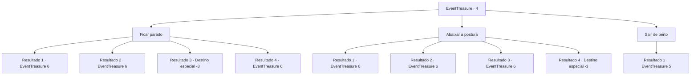

# Eventos de tesouro · 4

[Índice da tabela](index.md) · [Índice geral](../index.md)

ID: `pt:EventTreasure:4` · Fonte: `EventTreasure4` · Versão: 1.2.47.

Mapeamento estático dos arquivos; a disponibilidade e a execução dependem do estado da run.

## Texto do evento

Você chega até algumas ruínas abandonadas. Não há sinais de vida, mas você anda com cuidado, inspecionando a área. Assim que você dá um passo. <link=shake>CRACK!</link>o solo treme levemente. Você olha para baixo e percebe que a cor do solo é ligeiramente diferente da cor do ambiente.

## Dados de entrada

```json
{
  "id": 4,
  "grade": 1,
  "place": "",
  "required": "5_41_0"
}
```

## Mapa das escolhas



## Escolhas e resultados

### Escolha 1

Ficar parado

Requisitos e outros campos da escolha:

```json
{
  "required": ""
}
```

#### Resultado 1.1

Você empunha sua arma e fica parado, examinando a área. Nesse momento, o chão desmorona levando você a um lugar desconhecido. 

 Você perde a consciência por um tempo, e então abre os olhos para ver que caiu de uma grande altura. Você está perplexo ao ver como não morreu com a queda. Você luta para se levantar e encontra uma porta gigante e uma estátua de pedra à sua frente.|drawing_gate|

Continuação registrada: [Evento 6](0006.md) na mesma tabela.

```json
{
  "required": "",
  "chance": "7",
  "nextEvent": 6,
  "type": 2,
  "reward": ""
}
```

#### Resultado 1.2

Você empunha sua arma e fica parado, examinando a área. Nesse momento, o chão desmorona levando você a um lugar desconhecido. Você cai de uma grande altura e chega ao chão com um impacto tremendo. Você quase pode ouvir seus ossos gritarem de dor. Você finalmente se controla e olha para cima para ver uma porta gigante e uma estátua de pedra na sua frente.|drawing_gate|

Continuação registrada: [Evento 6](0006.md) na mesma tabela.

```json
{
  "required": "1_0_2",
  "chance": "15",
  "nextEvent": 6,
  "type": 1,
  "reward": "0_0_-1"
}
```

#### Resultado 1.3

Você empunha sua arma e fica parado, examinando a área. Nesse momento, o chão desmorona, levando você a um lugar desconhecido. Então, com um impacto tremendo, você perde a consciência.

Continuação registrada: [Destino especial `-3`](../destinos-especiais.md).

```json
{
  "required": "2_0_2",
  "chance": "15",
  "nextEvent": -3,
  "type": 1,
  "reward": "0_0_-1"
}
```

#### Resultado 1.4

Você empunha sua arma e fica parado, examinando a área. Nesse momento, o chão desmorona, levando você a um lugar desconhecido. Você cai de uma grande altura, mas para uma pessoa forte como você, isso nem deixa marcas. Você olha para cima e vê uma porta gigante e uma estátua de pedra à sua frente.|drawing_gate|

Continuação registrada: [Evento 6](0006.md) na mesma tabela.

```json
{
  "required": "",
  "chance": "1|0_13_1",
  "nextEvent": 6,
  "type": 0,
  "reward": ""
}
```

### Escolha 2

Abaixar a postura

Requisitos e outros campos da escolha:

```json
{
  "required": "1_6_8"
}
```

#### Resultado 2.1

Você sente que o chão pode desmoronar e abaixa sua postura. Quase simultaneamente, o solo desmorona, levando você a um lugar desconhecido. Você cai de uma grande altura, mas por algum motivo não cai de forma acelerada . Felizmente, você é capaz de flutuar com segurança até o solo. Você olha ao redor e encontra uma porta gigante e uma estátua de pedra.|drawing_gate|

Continuação registrada: [Evento 6](0006.md) na mesma tabela.

```json
{
  "required": "",
  "chance": "6",
  "nextEvent": 6,
  "type": 2,
  "reward": ""
}
```

#### Resultado 2.2

Você sente que o chão pode desmoronar e abaixa sua postura. Quase simultaneamente, o solo desmorona, levando você a um lugar desconhecido. Como um gato, você pula rapidamente da parede e cai no chão. Felizmente, você pousa no chão com segurança. Você olha ao redor e encontra uma porta gigante e uma estátua de pedra.|drawing_gate|

Continuação registrada: [Evento 6](0006.md) na mesma tabela.

```json
{
  "required": "",
  "chance": "1|0_6_1",
  "nextEvent": 6,
  "type": 0,
  "reward": ""
}
```

#### Resultado 2.3

Você sente que o chão pode desmoronar e abaixa sua postura. Nesse momento, o chão desmorona, levando você a um lugar desconhecido. Você cai de uma grande altura e chega ao chão com um impacto tremendo. Você quase pode ouvir seus ossos gritarem de dor. Você finalmente se controla e olha para cima para ver uma porta gigante e uma estátua de pedra na sua frente.|drawing_gate|

Continuação registrada: [Evento 6](0006.md) na mesma tabela.

```json
{
  "required": "1_0_2",
  "chance": "17",
  "nextEvent": 6,
  "type": 1,
  "reward": "0_0_-1"
}
```

#### Resultado 2.4

Você sente que o chão pode desmoronar e abaixa sua postura.  Nesse momento, o chão desmorona, levando você a um lugar desconhecido.  Então, com um impacto tremendo, você perde a consciência.

Continuação registrada: [Destino especial `-3`](../destinos-especiais.md).

```json
{
  "required": "2_0_2",
  "chance": "17",
  "nextEvent": -3,
  "type": 1,
  "reward": "0_0_-1"
}
```

### Escolha 3

Sair de perto

Requisitos e outros campos da escolha:

```json
{
  "required": "1_12_11"
}
```

#### Resultado 3.1

Você sente que o chão pode desmoronar e rapidamente recua.  Assim como você pensou, o solo desaba, criando um enorme buraco.

Continuação registrada: [Evento 5](0005.md) na mesma tabela.

```json
{
  "required": "",
  "chance": "1",
  "nextEvent": 5,
  "type": 2,
  "reward": ""
}
```

## Referências que chegam a este evento

Nenhum `nextEvent` positivo da mesma tabela aponta para este nó. Isso não prova que seja inacessível: sorteio e estado de história podem selecioná-lo.

