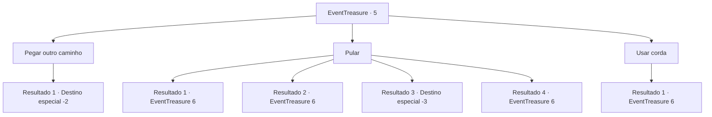

# Eventos de tesouro · 5

[Índice da tabela](index.md) · [Índice geral](../index.md)

ID: `pt:EventTreasure:5` · Fonte: `EventTreasure4` · Versão: 1.2.47.

Mapeamento estático dos arquivos; a disponibilidade e a execução dependem do estado da run.

## Texto do evento

*Sem texto no arquivo.*

## Dados de entrada

```json
{
  "id": 5,
  "grade": 1,
  "place": "",
  "required": ""
}
```

## Mapa das escolhas



## Escolhas e resultados

### Escolha 1

Pegar outro caminho

Requisitos e outros campos da escolha:

```json
{
  "required": ""
}
```

#### Resultado 1.1

Você olha para a cratera e se vira para seguir por outro caminho.

Continuação registrada: [Destino especial `-2`](../destinos-especiais.md).

```json
{
  "required": "",
  "chance": "1",
  "nextEvent": -2,
  "type": 2,
  "reward": ""
}
```

### Escolha 2

Pular 

Requisitos e outros campos da escolha:

```json
{
  "required": ""
}
```

#### Resultado 2.1

Você pula corajosamente para dentro do buraco. É incrivelmente alto, mas por algum motivo você não acelera na descida. Felizmente, você é capaz de flutuar com segurança até o solo. Você olha ao redor e encontra uma porta gigante e uma estátua de pedra.|drawing_gate|

Continuação registrada: [Evento 6](0006.md) na mesma tabela.

```json
{
  "required": "",
  "chance": "10",
  "nextEvent": 6,
  "type": 2,
  "reward": ""
}
```

#### Resultado 2.2

Você pula corajosamente para dentro do buraco. Você cai de uma grande altura e chega ao chão com um impacto tremendo. Você quase pode ouvir seus ossos gritarem de dor. Você finalmente se controla e olha para cima para ver uma porta gigante e uma estátua de pedra na sua frente.|drawing_gate|

Continuação registrada: [Evento 6](0006.md) na mesma tabela.

```json
{
  "required": "1_0_2",
  "chance": "10",
  "nextEvent": 6,
  "type": 1,
  "reward": "0_0_-1"
}
```

#### Resultado 2.3

Você pula corajosamente para dentro do buraco.  Então, com um impacto tremendo, você perde a consciência.

Continuação registrada: [Destino especial `-3`](../destinos-especiais.md).

```json
{
  "required": "2_0_2",
  "chance": "10",
  "nextEvent": -3,
  "type": 1,
  "reward": "0_0_-1"
}
```

#### Resultado 2.4

Você pula corajosamente para dentro do buraco. Você cai de uma grande altura e chega ao chão com um impacto tremendo. Você caiu de uma grande altura, mas para uma pessoa forte como você, isso nem deixa marcas. Você olha para cima e vê uma porta gigante e uma estátua de pedra à sua frente.|drawing_gate|

Continuação registrada: [Evento 6](0006.md) na mesma tabela.

```json
{
  "required": "",
  "chance": "1|0_13_1",
  "nextEvent": 6,
  "type": 0,
  "reward": ""
}
```

### Escolha 3

Usar corda

Requisitos e outros campos da escolha:

```json
{
  "required": "8_39_1"
}
```

#### Resultado 3.1

Você usa uma corda para descer no buraco. Ao chegar ao fim da corda, você vê que o buraco ainda está um pouco abaixo. Você pula e encontra uma porta gigante e uma estátua de pedra.|drawing_gate|

Continuação registrada: [Evento 6](0006.md) na mesma tabela.

```json
{
  "required": "",
  "chance": "1",
  "nextEvent": 6,
  "type": 2,
  "reward": "4_39_1"
}
```

## Referências que chegam a este evento

- [Evento 4 · escolha 3 · resultado 1](0004.md#escolha-3)
