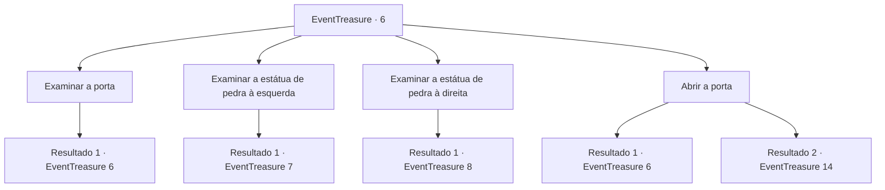

# Eventos de tesouro · 6

[Índice da tabela](index.md) · [Índice geral](../index.md)

ID: `pt:EventTreasure:6` · Fonte: `EventTreasure4` · Versão: 1.2.47.

Mapeamento estático dos arquivos; a disponibilidade e a execução dependem do estado da run.

## Texto do evento

*Sem texto no arquivo.*

## Dados de entrada

```json
{
  "id": 6,
  "grade": 1,
  "place": "",
  "required": ""
}
```

## Mapa das escolhas



## Escolhas e resultados

### Escolha 1

Examinar a porta

Requisitos e outros campos da escolha:

```json
{
  "required": "5_41_0"
}
```

#### Resultado 1.1

Você examina cuidadosamente a porta.  Há um pequeno texto rabiscado no meio da porta,  'Quando a esquerda e a direita se enfrentarem, o meio morrerá'

Continuação registrada: [Evento 6](0006.md) na mesma tabela.

```json
{
  "required": "",
  "chance": "1",
  "nextEvent": 6,
  "type": 2,
  "reward": "5_41_1"
}
```

### Escolha 2

Examinar a estátua de pedra à esquerda

Requisitos e outros campos da escolha:

```json
{
  "required": ""
}
```

#### Resultado 2.1

Ao examinar a estátua de pedra, você sente como se ela pudesse se mover a qualquer momento.  A estátua de pedra está voltada para a frente e parece que algo foi arrastado pelo chão.

Continuação registrada: [Evento 7](0007.md) na mesma tabela.

```json
{
  "required": "",
  "chance": "1",
  "nextEvent": 7,
  "type": 2,
  "reward": ""
}
```

### Escolha 3

Examinar a estátua de pedra à direita

Requisitos e outros campos da escolha:

```json
{
  "required": ""
}
```

#### Resultado 3.1

Ao examinar a estátua de pedra, você sente como se ela pudesse se mover a qualquer momento.  A estátua de pedra está voltada para a frente e parece que algo foi arrastado pelo chão.

Continuação registrada: [Evento 8](0008.md) na mesma tabela.

```json
{
  "required": "",
  "chance": "1",
  "nextEvent": 8,
  "type": 2,
  "reward": ""
}
```

### Escolha 4

Abrir a porta

Requisitos e outros campos da escolha:

```json
{
  "required": "5_41_1"
}
```

#### Resultado 4.1

Você coloca as mãos na porta de pedra e empurra o máximo que pode, mas ela não se move.

Continuação registrada: [Evento 6](0006.md) na mesma tabela.

```json
{
  "required": "",
  "chance": "30",
  "nextEvent": 6,
  "type": 1,
  "reward": "5_41_2"
}
```

#### Resultado 4.2

Você abre a porta de pedra com sua força.  Nesse momento, a estátua de pedra começa a brilhar em vermelho e depois se desintegra.  O espaço exposto pela porta está escuro como breu, parece que você está sendo sugado para um buraco negro.

Continuação registrada: [Evento 14](0014.md) na mesma tabela.

```json
{
  "required": "",
  "chance": "1|0_5_1",
  "nextEvent": 14,
  "type": 0,
  "reward": ""
}
```

## Referências que chegam a este evento

- [Evento 4 · escolha 1 · resultado 1](0004.md#escolha-1)
- [Evento 4 · escolha 1 · resultado 2](0004.md#escolha-1)
- [Evento 4 · escolha 1 · resultado 4](0004.md#escolha-1)
- [Evento 4 · escolha 2 · resultado 1](0004.md#escolha-2)
- [Evento 4 · escolha 2 · resultado 2](0004.md#escolha-2)
- [Evento 4 · escolha 2 · resultado 3](0004.md#escolha-2)
- [Evento 5 · escolha 2 · resultado 1](0005.md#escolha-2)
- [Evento 5 · escolha 2 · resultado 2](0005.md#escolha-2)
- [Evento 5 · escolha 2 · resultado 4](0005.md#escolha-2)
- [Evento 5 · escolha 3 · resultado 1](0005.md#escolha-3)
- [Evento 6 · escolha 1 · resultado 1](0006.md#escolha-1)
- [Evento 6 · escolha 4 · resultado 1](0006.md#escolha-4)
