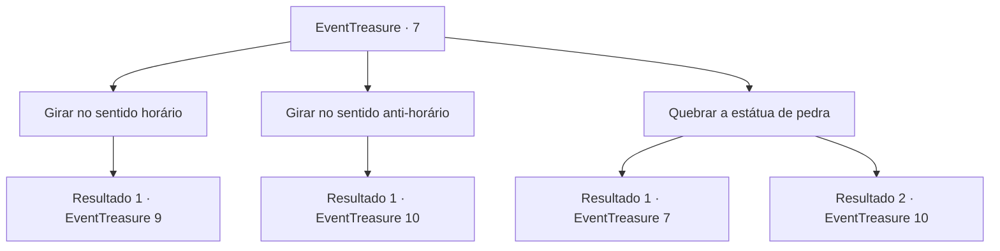

# Eventos de tesouro · 7

[Índice da tabela](index.md) · [Índice geral](../index.md)

ID: `pt:EventTreasure:7` · Fonte: `EventTreasure4` · Versão: 1.2.47.

Mapeamento estático dos arquivos; a disponibilidade e a execução dependem do estado da run.

## Texto do evento

*Sem texto no arquivo.*

## Dados de entrada

```json
{
  "id": 7,
  "grade": 1,
  "place": "",
  "required": ""
}
```

## Mapa das escolhas



## Escolhas e resultados

### Escolha 1

Girar no sentido horário

Requisitos e outros campos da escolha:

```json
{
  "required": ""
}
```

#### Resultado 1.1

Você vira a estátua de pedra à esquerda no sentido horário. A estátua de pedra começa a brilhar em vermelho e se mover. 

 "Errado. Exilado."

 A estátua de pedra está segurando um tridente. Ela corre em sua direção.

Continuação registrada: [Evento 9](0009.md) na mesma tabela.

```json
{
  "required": "",
  "chance": "1",
  "nextEvent": 9,
  "type": 2,
  "reward": "6_0_37",
  "place": 7
}
```

### Escolha 2

Girar no sentido anti-horário

Requisitos e outros campos da escolha:

```json
{
  "required": ""
}
```

#### Resultado 2.1

Você vira a estátua de pedra esquerda no sentido anti-horário.  
<link=shake>'Clunk'</link>
  Quando a estátua de pedra da esquerda fica de frente para a estátua de pedra da direita,  um som de metal profundo ecoa por toda a câmara.

Continuação registrada: [Evento 10](0010.md) na mesma tabela.

```json
{
  "required": "",
  "chance": "1",
  "nextEvent": 10,
  "type": 2,
  "reward": "5_14_2"
}
```

### Escolha 3

Quebrar a estátua de pedra

Requisitos e outros campos da escolha:

```json
{
  "required": "5_14_0"
}
```

#### Resultado 3.1

Você balança sua arma para quebrar a estátua de pedra.  Mas sua arma ricocheteia em algo invisível.

Continuação registrada: [Evento 7](0007.md) na mesma tabela.

```json
{
  "required": "",
  "chance": "10",
  "nextEvent": 7,
  "type": 1,
  "reward": "5_14_1"
}
```

#### Resultado 3.2

A estátua de pedra é protegida por um encanto mágico.  Demora várias horas, mas você descobre a base do encantamento.  E você pode desativá-lo.  Você concentra sua energia dentro do núcleo da estátua de pedra e a estilhaça por dentro.

Continuação registrada: [Evento 10](0010.md) na mesma tabela.

```json
{
  "required": "1_1_2",
  "chance": "1|0_7_1",
  "nextEvent": 10,
  "type": 0,
  "reward": "5_14_2|0_1_-1|0_2_1"
}
```

## Referências que chegam a este evento

- [Evento 6 · escolha 2 · resultado 1](0006.md#escolha-2)
- [Evento 7 · escolha 3 · resultado 1](0007.md#escolha-3)
