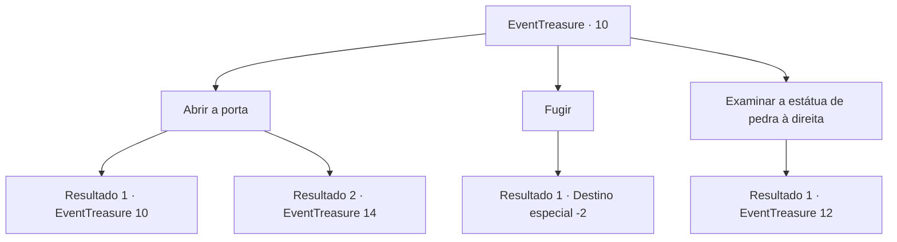

# Eventos de tesouro · 10

[Índice da tabela](index.md) · [Índice geral](../index.md)

ID: `pt:EventTreasure:10` · Fonte: `EventTreasure4` · Versão: 1.2.47.

Mapeamento estático dos arquivos; a disponibilidade e a execução dependem do estado da run.

## Texto do evento

*Sem texto no arquivo.*

## Dados de entrada

```json
{
  "id": 10,
  "grade": 1,
  "place": "",
  "required": "5_14_2"
}
```

## Mapa das escolhas



## Escolhas e resultados

### Escolha 1

Abrir a porta

Requisitos e outros campos da escolha:

```json
{
  "required": "5_41_1"
}
```

#### Resultado 1.1

Você empurra com todas as suas forças, mas a porta nem mesmo se move.

Continuação registrada: [Evento 10](0010.md) na mesma tabela.

```json
{
  "required": "",
  "chance": "15",
  "nextEvent": 10,
  "type": 1,
  "reward": "5_41_2"
}
```

#### Resultado 1.2

Você abre a porta de pedra com sua força.  Nesse momento, a estátua de pedra começa a brilhar em vermelho e depois se desintegra.  O espaço exposto pela porta está escuro como breu, parece que você está sendo sugado para um buraco negro.

Continuação registrada: [Evento 14](0014.md) na mesma tabela.

```json
{
  "required": "",
  "chance": "1|0_5_1",
  "nextEvent": 14,
  "type": 0,
  "reward": ""
}
```

### Escolha 2

Fugir

Requisitos e outros campos da escolha:

```json
{
  "required": ""
}
```

#### Resultado 2.1

Você se vira na frente da porta e sai correndo.

Continuação registrada: [Destino especial `-2`](../destinos-especiais.md).

```json
{
  "required": "",
  "chance": "1",
  "nextEvent": -2,
  "type": 2,
  "reward": "5_41_9"
}
```

### Escolha 3

Examinar a estátua de pedra à direita

Requisitos e outros campos da escolha:

```json
{
  "required": ""
}
```

#### Resultado 3.1

Você fica em frente à estátua de pedra à direita.

Continuação registrada: [Evento 12](0012.md) na mesma tabela.

```json
{
  "required": "",
  "chance": "1",
  "nextEvent": 12,
  "type": 2,
  "reward": ""
}
```

## Referências que chegam a este evento

- [Evento 7 · escolha 2 · resultado 1](0007.md#escolha-2)
- [Evento 7 · escolha 3 · resultado 2](0007.md#escolha-3)
- [Evento 10 · escolha 1 · resultado 1](0010.md#escolha-1)
