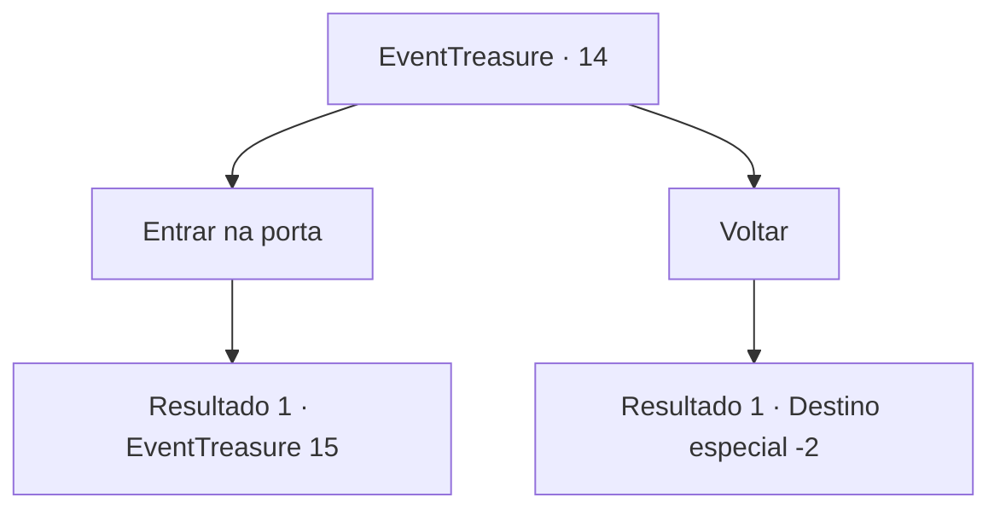

# Eventos de tesouro · 14

[Índice da tabela](index.md) · [Índice geral](../index.md)

ID: `pt:EventTreasure:14` · Fonte: `EventTreasure4` · Versão: 1.2.47.

Mapeamento estático dos arquivos; a disponibilidade e a execução dependem do estado da run.

## Texto do evento

*Sem texto no arquivo.*

## Dados de entrada

```json
{
  "id": 14,
  "grade": 1,
  "place": "",
  "required": ""
}
```

## Mapa das escolhas



## Escolhas e resultados

### Escolha 1

Entrar na porta

Requisitos e outros campos da escolha:

```json
{
  "required": ""
}
```

#### Resultado 1.1

Você passa pela porta enorme e entra em uma sala espaçosa.  Conforme você dá um passo para dentro da sala, as tochas na parede iluminam a área.  Existem ossos brancos em todo o quarto espaçoso.  E no meio da sala há um baú muito antigo.

Continuação registrada: [Evento 15](0015.md) na mesma tabela.

```json
{
  "required": "",
  "chance": "1",
  "nextEvent": 15,
  "type": 2,
  "reward": "5_41_3"
}
```

### Escolha 2

Voltar

Requisitos e outros campos da escolha:

```json
{
  "required": ""
}
```

#### Resultado 2.1

Você sente algo errado na boca do estômago ao caminhar pela sala.

Continuação registrada: [Destino especial `-2`](../destinos-especiais.md).

```json
{
  "required": "",
  "chance": "1",
  "nextEvent": -2,
  "type": 2,
  "reward": "5_41_9"
}
```

## Referências que chegam a este evento

- [Evento 6 · escolha 4 · resultado 2](0006.md#escolha-4)
- [Evento 10 · escolha 1 · resultado 2](0010.md#escolha-1)
- [Evento 11 · escolha 1 · resultado 2](0011.md#escolha-1)
- [Evento 12 · escolha 1 · resultado 1](0012.md#escolha-1)
- [Evento 12 · escolha 3 · resultado 2](0012.md#escolha-3)
- [Evento 12 · escolha 3 · resultado 3](0012.md#escolha-3)
- [Evento 13 · escolha 2 · resultado 1](0013.md#escolha-2)
- [Evento 13 · escolha 3 · resultado 2](0013.md#escolha-3)
- [Evento 13 · escolha 3 · resultado 3](0013.md#escolha-3)
