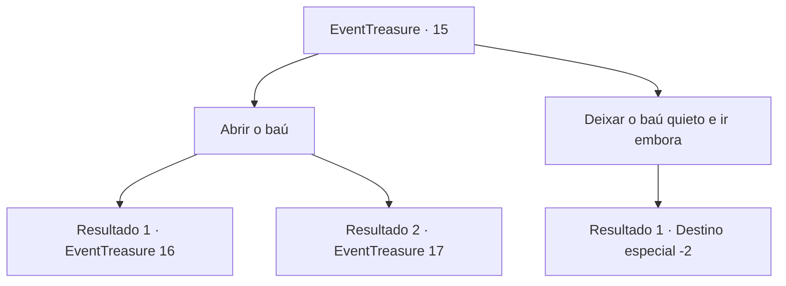

# Eventos de tesouro · 15

[Índice da tabela](index.md) · [Índice geral](../index.md)

ID: `pt:EventTreasure:15` · Fonte: `EventTreasure4` · Versão: 1.2.47.

Mapeamento estático dos arquivos; a disponibilidade e a execução dependem do estado da run.

## Texto do evento

*Sem texto no arquivo.*

## Dados de entrada

```json
{
  "id": 15,
  "grade": 1,
  "place": "",
  "required": ""
}
```

## Mapa das escolhas



## Escolhas e resultados

### Escolha 1

Abrir o baú

Requisitos e outros campos da escolha:

```json
{
  "required": ""
}
```

#### Resultado 1.1

Dentro do baú está um cálice de bronze manchado de sangue. Conforme você tenta juntar as coisas em sua bolsa, as tochas na parede se apagam. |drawing_torchOff| O quarto fica escuro como breu. Você é dominado pela escuridão e ouve algo estremecer.

Continuação registrada: [Evento 16](0016.md) na mesma tabela.

```json
{
  "required": "21_26_1",
  "chance": "1",
  "nextEvent": 16,
  "type": 2,
  "reward": ""
}
```

#### Resultado 1.2

Dentro do baú está um cálice de bronze manchado de sangue. Conforme você tenta juntar as coisas em sua bolsa, as tochas na parede se apagam. |drawing_torchOff| O quarto fica escuro como breu. Na escuridão, você testemunha os esqueletos espalhados se levantando.

Continuação registrada: [Evento 17](0017.md) na mesma tabela.

```json
{
  "required": "20_26_1",
  "chance": "1",
  "nextEvent": 17,
  "type": 2,
  "reward": "6_0_12",
  "place": 7
}
```

### Escolha 2

Deixar o baú quieto e ir embora

Requisitos e outros campos da escolha:

```json
{
  "required": ""
}
```

#### Resultado 2.1

Você olha desconfiado para o baú e se vira para sair.

Continuação registrada: [Destino especial `-2`](../destinos-especiais.md).

```json
{
  "required": "",
  "chance": "1",
  "nextEvent": -2,
  "type": 2,
  "reward": "5_41_9"
}
```

## Referências que chegam a este evento

- [Evento 9 · escolha 1 · resultado 1](0009.md#escolha-1)
- [Evento 14 · escolha 1 · resultado 1](0014.md#escolha-1)
