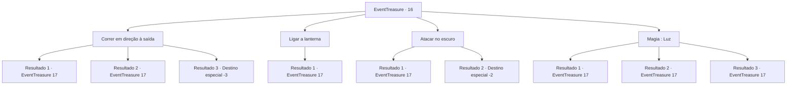

# Eventos de tesouro · 16

[Índice da tabela](index.md) · [Índice geral](../index.md)

ID: `pt:EventTreasure:16` · Fonte: `EventTreasure4` · Versão: 1.2.47.

Mapeamento estático dos arquivos; a disponibilidade e a execução dependem do estado da run.

## Texto do evento

*Sem texto no arquivo.*

## Dados de entrada

```json
{
  "id": 16,
  "grade": 1,
  "place": "",
  "required": ""
}
```

## Mapa das escolhas



## Escolhas e resultados

### Escolha 1

Correr em direção à saída

Requisitos e outros campos da escolha:

```json
{
  "required": ""
}
```

#### Resultado 1.1

Uma lasca de luz está brilhando através da enorme entrada.  Você corre em direção a ele a toda velocidade.  'Woosh' as ​​flechas passam voando, errando você por pouco.  Você tem sorte o suficiente para desviar das flechas e escapar com sucesso da sala.  Então, a entidade que atirou em você revela sua identidade no escuro.  Algo feito de ossos brancos estranhamente caminha em sua direção.

Continuação registrada: [Evento 17](0017.md) na mesma tabela.

```json
{
  "required": "",
  "chance": "1|0_6_1",
  "nextEvent": 17,
  "type": 0,
  "reward": "6_0_12",
  "place": 7
}
```

#### Resultado 1.2

Uma lasca de luz está brilhando através da enorme entrada.  Você corre em direção a ele a toda velocidade.  'Woosh' as ​​flechas voam em sua direção.  Você tenta mover o corpo para se esquivar das flechas, mas não consegue. Uma das flechas atinge sua perna.  A dor paralisa sua perna e você cai no chão.  Então, a entidade que atirou em você revela sua identidade no escuro.  Algo feito de ossos brancos estranhamente caminha em sua direção.

Continuação registrada: [Evento 17](0017.md) na mesma tabela.

```json
{
  "required": "1_0_2",
  "chance": "9",
  "nextEvent": 17,
  "type": 1,
  "reward": "0_0_-1|6_0_12",
  "place": 7
}
```

#### Resultado 1.3

Uma lasca de luz está brilhando através da enorme entrada.  Você corre em direção a ele a toda velocidade.  'Woosh' as ​​flechas voam em sua direção. Você não é capaz de desviar das flechas e morre.

Continuação registrada: [Destino especial `-3`](../destinos-especiais.md).

```json
{
  "required": "2_0_2",
  "chance": "9",
  "nextEvent": -3,
  "type": 2,
  "reward": "0_0_-1"
}
```

### Escolha 2

Ligar a lanterna

Requisitos e outros campos da escolha:

```json
{
  "required": "8_42_1"
}
```

#### Resultado 2.1

Você acende a lanterna para iluminar o ambiente.  Você vê os ossos no chão se movendo e se tornando animados.

Continuação registrada: [Evento 17](0017.md) na mesma tabela.

```json
{
  "required": "",
  "chance": "1",
  "nextEvent": 17,
  "type": 2,
  "reward": "6_0_12",
  "place": 7
}
```

### Escolha 3

Atacar no escuro

Requisitos e outros campos da escolha:

```json
{
  "required": ""
}
```

#### Resultado 3.1

Você cegamente balança sua arma pelo ar. Eventualmente, atinge algo.  Você começa a lutar contra uma silhueta que mal consegue distinguir no escuro.

Continuação registrada: [Evento 17](0017.md) na mesma tabela.

```json
{
  "required": "",
  "chance": "12",
  "nextEvent": 17,
  "type": 1,
  "reward": "6_3_12",
  "place": 7
}
```

#### Resultado 3.2

Você cegamente balança sua arma pelo ar.  Eventualmente, ela atinge algo pesado e o choque atinge o cabo.  Os esqueletos se estilhaçam em pedacinhos.  Você tira a poeira dos ossos empoeirados e caminha em direção ao baú.  Então você coleta as coisas dentro do baú e deixa as ruínas.

Continuação registrada: [Destino especial `-2`](../destinos-especiais.md).

```json
{
  "required": "",
  "chance": "1|0_5_1",
  "nextEvent": -2,
  "type": 0,
  "reward": "3_49_1|0_1_2|0_2_2|0_4_30|5_41_9"
}
```

### Escolha 4

Magia : Luz

Requisitos e outros campos da escolha:

```json
{
  "required": "20_0_1"
}
```

#### Resultado 4.1

Você se lembra de um feitiço de iluminação simples, mas não conseguiu lançá-lo na pressa.  Você começa a lutar contra uma silhueta que mal consegue distinguir no escuro.

Continuação registrada: [Evento 17](0017.md) na mesma tabela.

```json
{
  "required": "",
  "chance": "15",
  "nextEvent": 17,
  "type": 1,
  "reward": "6_3_12",
  "place": 7
}
```

#### Resultado 4.2

Você lança um feitiço simples para iluminar o ambiente.  Você vê os ossos no chão se movendo e se tornando animados.

Continuação registrada: [Evento 17](0017.md) na mesma tabela.

```json
{
  "required": "",
  "chance": "1|0_7_1",
  "nextEvent": 17,
  "type": 0,
  "reward": "6_0_12",
  "place": 7
}
```

#### Resultado 4.3

Você lança um feitiço simples para iluminar o ambiente.  Você vê os ossos no chão se movendo e se tornando animados.

Continuação registrada: [Evento 17](0017.md) na mesma tabela.

```json
{
  "required": "",
  "chance": "1|0_12_1",
  "nextEvent": 17,
  "type": 0,
  "reward": "6_0_12",
  "place": 7
}
```

## Referências que chegam a este evento

- [Evento 15 · escolha 1 · resultado 1](0015.md#escolha-1)
