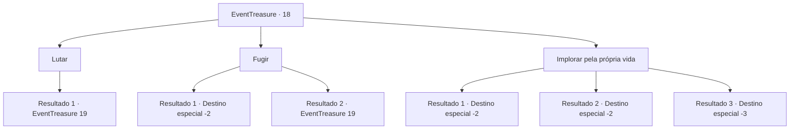

# Eventos de tesouro · 18

[Índice da tabela](index.md) · [Índice geral](../index.md)

ID: `pt:EventTreasure:18` · Fonte: `EventTreasure4` · Versão: 1.2.47.

Mapeamento estático dos arquivos; a disponibilidade e a execução dependem do estado da run.

## Texto do evento

|drawing_digging| Você encontra algumas pessoas enterrando algo. Eles param para respirar e limpar o suor. Ao notar você eles gritam surpresos. Um silêncio constrangedor toma conta do ar. Então as pessoas se aproximam de você com suas pás. 

 "..Desculpe por ter que fazer isso. Mas não podemos te deixar sair daqui vivo."


## Dados de entrada

```json
{
  "id": 18,
  "grade": 1,
  "place": "",
  "required": "2_2_30"
}
```

## Mapa das escolhas



## Escolhas e resultados

### Escolha 1

Lutar

Requisitos e outros campos da escolha:

```json
{
  "required": ""
}
```

#### Resultado 1.1

Você não sabe o que eles estão tentando encobrir, mas decide lutar contra eles.

Continuação registrada: [Evento 19](0019.md) na mesma tabela.

```json
{
  "required": "",
  "chance": "1",
  "nextEvent": 19,
  "type": 2,
  "reward": "6_0_2",
  "place": 0
}
```

### Escolha 2

Fugir

Requisitos e outros campos da escolha:

```json
{
  "required": ""
}
```

#### Resultado 2.1

Você foge deles o mais rápido possível.

Continuação registrada: [Destino especial `-2`](../destinos-especiais.md).

```json
{
  "required": "",
  "chance": "1|0_6_1",
  "nextEvent": -2,
  "type": 0,
  "reward": ""
}
```

#### Resultado 2.2

Você tenta fugir deles, mas eles te alcançam.

Continuação registrada: [Evento 19](0019.md) na mesma tabela.

```json
{
  "required": "",
  "chance": "7",
  "nextEvent": 19,
  "type": 1,
  "reward": "6_0_2",
  "place": 0
}
```

### Escolha 3

Implorar pela própria vida

Requisitos e outros campos da escolha:

```json
{
  "required": ""
}
```

#### Resultado 3.1

Você tenta convencê-los de que não viu nada.  Mas eles batem na sua cabeça com uma pá.  Você perde a consciência. Você não sabe quanto tempo se passou,  mas você acorda em um arbusto.

Continuação registrada: [Destino especial `-2`](../destinos-especiais.md).

```json
{
  "required": "1_0_2",
  "chance": "10",
  "nextEvent": -2,
  "type": 1,
  "reward": "0_0_-1"
}
```

#### Resultado 3.2

Você tenta convencê-los de que não viu nada.  Eles conversam brevemente um com o outro e depois se voltam para falar com você.  

 "Ok, saia daqui. Você não viu nada."

  Você sai rapidamente de cena.

Continuação registrada: [Destino especial `-2`](../destinos-especiais.md).

```json
{
  "required": "",
  "chance": "1|0_12_1",
  "nextEvent": -2,
  "type": 0,
  "reward": ""
}
```

#### Resultado 3.3

Você tenta convencê-los de que não viu nada.  Mas eles batem na sua cabeça com uma pá.  Você perde a consciência.

Continuação registrada: [Destino especial `-3`](../destinos-especiais.md).

```json
{
  "required": "2_0_2",
  "chance": "10",
  "nextEvent": -3,
  "type": 2,
  "reward": "0_0_-1"
}
```

## Referências que chegam a este evento

Nenhum `nextEvent` positivo da mesma tabela aponta para este nó. Isso não prova que seja inacessível: sorteio e estado de história podem selecioná-lo.

