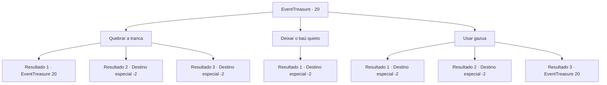

# Eventos de tesouro · 20

[Índice da tabela](index.md) · [Índice geral](../index.md)

ID: `pt:EventTreasure:20` · Fonte: `EventTreasure4` · Versão: 1.2.47.

Mapeamento estático dos arquivos; a disponibilidade e a execução dependem do estado da run.

## Texto do evento

*Sem texto no arquivo.*

## Dados de entrada

```json
{
  "id": 20,
  "grade": 1,
  "place": "",
  "required": ""
}
```

## Mapa das escolhas



## Escolhas e resultados

### Escolha 1

Quebrar a tranca

Requisitos e outros campos da escolha:

```json
{
  "required": "5_38_0"
}
```

#### Resultado 1.1

Você bate na fechadura o mais forte que pode. Mas a fechadura continua igual.

Continuação registrada: [Evento 20](0020.md) na mesma tabela.

```json
{
  "required": "",
  "chance": "18",
  "nextEvent": 20,
  "type": 1,
  "reward": "5_38_1"
}
```

#### Resultado 1.2

Você acerta a fechadura o mais forte que pode e a fechadura acende, e então ela se divide em duas.  O baú aberto está cheio de ouro.  Você pega o ouro e continua em sua aventura.

Continuação registrada: [Destino especial `-2`](../destinos-especiais.md).

```json
{
  "required": "",
  "chance": "1|0_5_2",
  "nextEvent": -2,
  "type": 0,
  "reward": "0_4_100|0_2_1"
}
```

#### Resultado 1.3

Você bate na fechadura o mais forte que pode e o baú explode.  O conteúdo da caixa explode para fora, rasgando tudo em seu caminho.

Continuação registrada: [Destino especial `-2`](../destinos-especiais.md).

```json
{
  "required": "",
  "chance": "1|0_5_1",
  "nextEvent": -2,
  "type": 0,
  "reward": "0_0_-1"
}
```

### Escolha 2

Deixar o baú quieto

Requisitos e outros campos da escolha:

```json
{
  "required": ""
}
```

#### Resultado 2.1

Você desiste de abrir o baú e segue em frente.

Continuação registrada: [Destino especial `-2`](../destinos-especiais.md).

```json
{
  "required": "",
  "chance": "1",
  "nextEvent": -2,
  "type": 2,
  "reward": ""
}
```

### Escolha 3

Usar gazua

Requisitos e outros campos da escolha:

```json
{
  "required": "8_41_1"
}
```

#### Resultado 3.1

Você abre o baú com a gazua. No processo, a gazua quebra.  O baú está cheio de ouro.  Você coleta o ouro e continua em sua aventura.

Continuação registrada: [Destino especial `-2`](../destinos-especiais.md).

```json
{
  "required": "",
  "chance": "1|0_6_2",
  "nextEvent": -2,
  "type": 0,
  "reward": "0_4_100|4_41_1|0_2_1"
}
```

#### Resultado 3.2

Você abre o baú com a gazua.  O baú está cheio de ouro.  Você coleta o ouro e continua em sua aventura.

Continuação registrada: [Destino especial `-2`](../destinos-especiais.md).

```json
{
  "required": "",
  "chance": "1|0_6_1",
  "nextEvent": -2,
  "type": 0,
  "reward": "0_4_100|0_2_1"
}
```

#### Resultado 3.3

Você enfia a gazua dentro da fechadura, sacudindo-a para cima e para baixo. No processo, a gazua quebra. Mas a fechadura não mostra sinais de abertura.

Continuação registrada: [Evento 20](0020.md) na mesma tabela.

```json
{
  "required": "",
  "chance": "15",
  "nextEvent": 20,
  "type": 1,
  "reward": "4_41_1"
}
```

## Referências que chegam a este evento

- [Evento 19 · escolha 1 · resultado 1](0019.md#escolha-1)
- [Evento 20 · escolha 1 · resultado 1](0020.md#escolha-1)
- [Evento 20 · escolha 3 · resultado 3](0020.md#escolha-3)
