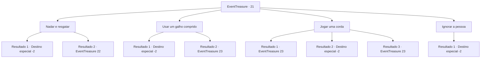

# Eventos de tesouro · 21

[Índice da tabela](index.md) · [Índice geral](../index.md)

ID: `pt:EventTreasure:21` · Fonte: `EventTreasure4` · Versão: 1.2.47.

Mapeamento estático dos arquivos; a disponibilidade e a execução dependem do estado da run.

## Texto do evento

Um chuvisco começa a virar uma chuva torrencial. Você não tem escolha a não ser montar sua tenda debaixo de uma árvore gigante. Há um pequeno riacho fluindo abaixo do morro debaixo da árvore gigante, e a água começa a subir rapidamente. E então, você ouve gritos de socorro de uma mulher enquanto é levada rio abaixo. 

 "Ahh!! Alguém me ajuda!!!"


## Dados de entrada

```json
{
  "id": 21,
  "grade": 1,
  "place": "",
  "required": "5_26_0"
}
```

## Mapa das escolhas



## Escolhas e resultados

### Escolha 1

Nadar e resgatar

Requisitos e outros campos da escolha:

```json
{
  "required": ""
}
```

#### Resultado 1.1

Você tira a roupa e pula no riacho que transborda.  E você é dominado pela correnteza.  Você agita os braços e, de alguma forma, consegue sair da água.  No entanto, a pessoa que você estava tentando salvar já desceu riacho abaixo.

Continuação registrada: [Destino especial `-2`](../destinos-especiais.md).

```json
{
  "required": "",
  "chance": "11",
  "nextEvent": -2,
  "type": 1,
  "reward": "0_0_-1|5_26_1"
}
```

#### Resultado 1.2

Você tira a roupa e pula no riacho que transborda.  A água está fluindo rapidamente, mas você é instintivamente capaz de atravessá-la a nado.  Você resgatou a pessoa com sucesso.  Mas ela está inconsciente.

Continuação registrada: [Evento 22](0022.md) na mesma tabela.

```json
{
  "required": "",
  "chance": "1|0_5_1",
  "nextEvent": 22,
  "type": 0,
  "reward": ""
}
```

### Escolha 2

Usar um galho comprido

Requisitos e outros campos da escolha:

```json
{
  "required": ""
}
```

#### Resultado 2.1

Você usa um longo galho próximo e o estende para a pessoa.  Ela consegue agarrar o galho.  Mas você não é forte o suficiente para suportar o peso dela e ela é arrastada com o galho.

Continuação registrada: [Destino especial `-2`](../destinos-especiais.md).

```json
{
  "required": "",
  "chance": "13",
  "nextEvent": -2,
  "type": 1,
  "reward": "0_1_-1|5_26_1"
}
```

#### Resultado 2.2

Você usa um longo galho próximo para chegar até a pessoa.  Ela consegue agarrar o galho.  Você rapidamente tira ela da água.  Assim que ela sai, ela começa a reclamar.  

 "Ei, você viu minha mochila flutuar?"


Continuação registrada: [Evento 23](0023.md) na mesma tabela.

```json
{
  "required": "",
  "chance": "1|0_6_1",
  "nextEvent": 23,
  "type": 0,
  "reward": ""
}
```

### Escolha 3

Jogar uma corda

Requisitos e outros campos da escolha:

```json
{
  "required": "8_39_1"
}
```

#### Resultado 3.1

Você rapidamente amarra uma ponta da corda em uma grande árvore.  Então você joga a outra extremidade para a pessoa.  Ela consegue agarrar a corda e se puxar para a margem.  A corda funciona conforme planejado, mas não parece mais utilizável.  Assim que ela sai da água, começa a reclamar.  

 "Ei, você viu minha mochila flutuar?"


Continuação registrada: [Evento 23](0023.md) na mesma tabela.

```json
{
  "required": "21_0_1",
  "chance": "1|0_6_1",
  "nextEvent": 23,
  "type": 0,
  "reward": "4_39_1"
}
```

#### Resultado 3.2

Você rapidamente amarra uma ponta da corda em uma grande árvore. Então você joga a outra extremidade para a pessoa. Mas ela já está longe demais. Você pega as cordas novamente.

Continuação registrada: [Destino especial `-2`](../destinos-especiais.md).

```json
{
  "required": "21_0_1",
  "chance": "8",
  "nextEvent": -2,
  "type": 1,
  "reward": ""
}
```

#### Resultado 3.3

Você rapidamente puxa a corda e lança um feitiço.  A corda se moveu sozinha, pegando o humano à deriva.  A corda que fazia seu trabalho foi cortada.  Assim que ela sai da água, ela começa a reclamar.  

 "Ei, você viu minha mochila flutuar?"


Continuação registrada: [Evento 23](0023.md) na mesma tabela.

```json
{
  "required": "20_0_1",
  "chance": "1",
  "nextEvent": 23,
  "type": 2,
  "reward": "4_39_1"
}
```

### Escolha 4

Ignorar a pessoa

Requisitos e outros campos da escolha:

```json
{
  "required": ""
}
```

#### Resultado 4.1

Você finge não notar a pessoa. Os gritos vão embora com a correnteza.

Continuação registrada: [Destino especial `-2`](../destinos-especiais.md).

```json
{
  "required": "",
  "chance": "1",
  "nextEvent": -2,
  "type": 2,
  "reward": "5_26_1"
}
```

## Referências que chegam a este evento

Nenhum `nextEvent` positivo da mesma tabela aponta para este nó. Isso não prova que seja inacessível: sorteio e estado de história podem selecioná-lo.

