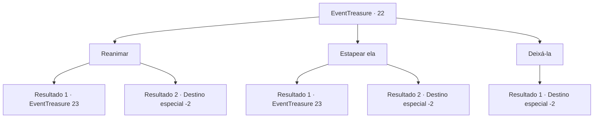

# Eventos de tesouro · 22

[Índice da tabela](index.md) · [Índice geral](../index.md)

ID: `pt:EventTreasure:22` · Fonte: `EventTreasure4` · Versão: 1.2.47.

Mapeamento estático dos arquivos; a disponibilidade e a execução dependem do estado da run.

## Texto do evento

*Sem texto no arquivo.*

## Dados de entrada

```json
{
  "id": 22,
  "grade": 1,
  "place": "",
  "required": ""
}
```

## Mapa das escolhas



## Escolhas e resultados

### Escolha 1

Reanimar

Requisitos e outros campos da escolha:

```json
{
  "required": ""
}
```

#### Resultado 1.1

Você usa sua mão para pressionar ritmicamente o peito dela. Depois de algumas vezes, ela tosse um pouco d'água.  Ela acorda tossindo, tentando recuperar o fôlego. Depois de abrir os olhos, ela olha em volta e pergunta.  

 "Ei, você viu minha mochila flutuar?"


Continuação registrada: [Evento 23](0023.md) na mesma tabela.

```json
{
  "required": "",
  "chance": "1|0_7_1",
  "nextEvent": 23,
  "type": 0,
  "reward": ""
}
```

#### Resultado 1.2

Você usa sua mão para pressionar ritmicamente o peito dela. No entanto, nada acontece.  Você não tem escolha a não ser deixar o corpo.

Continuação registrada: [Destino especial `-2`](../destinos-especiais.md).

```json
{
  "required": "",
  "chance": "10",
  "nextEvent": -2,
  "type": 1,
  "reward": "5_26_1"
}
```

### Escolha 2

Estapear ela

Requisitos e outros campos da escolha:

```json
{
  "required": ""
}
```

#### Resultado 2.1

Você dá um tapa forte na mulher inconsciente. Depois de levar um tapa, ela tosse um pouco de água.  Ela acorda tossindo, tentando recuperar o fôlego. Depois de abrir os olhos, ela olha em volta e pergunta.  

 "Ei, você viu minha mochila flutuar?"


Continuação registrada: [Evento 23](0023.md) na mesma tabela.

```json
{
  "required": "",
  "chance": "1|0_5_1",
  "nextEvent": 23,
  "type": 0,
  "reward": ""
}
```

#### Resultado 2.2

Você dá um tapa forte na mulher inconsciente. No entanto, nada acontece.  Não há outra escolha a não ser deixar seu corpo.

Continuação registrada: [Destino especial `-2`](../destinos-especiais.md).

```json
{
  "required": "",
  "chance": "12",
  "nextEvent": -2,
  "type": 1,
  "reward": "5_26_1"
}
```

### Escolha 3

Deixá-la

Requisitos e outros campos da escolha:

```json
{
  "required": ""
}
```

#### Resultado 3.1

Você a puxa para fora da água e a deixa ela lá.

Continuação registrada: [Destino especial `-2`](../destinos-especiais.md).

```json
{
  "required": "",
  "chance": "1",
  "nextEvent": -2,
  "type": 2,
  "reward": "5_26_1"
}
```

## Referências que chegam a este evento

- [Evento 21 · escolha 1 · resultado 2](0021.md#escolha-1)
