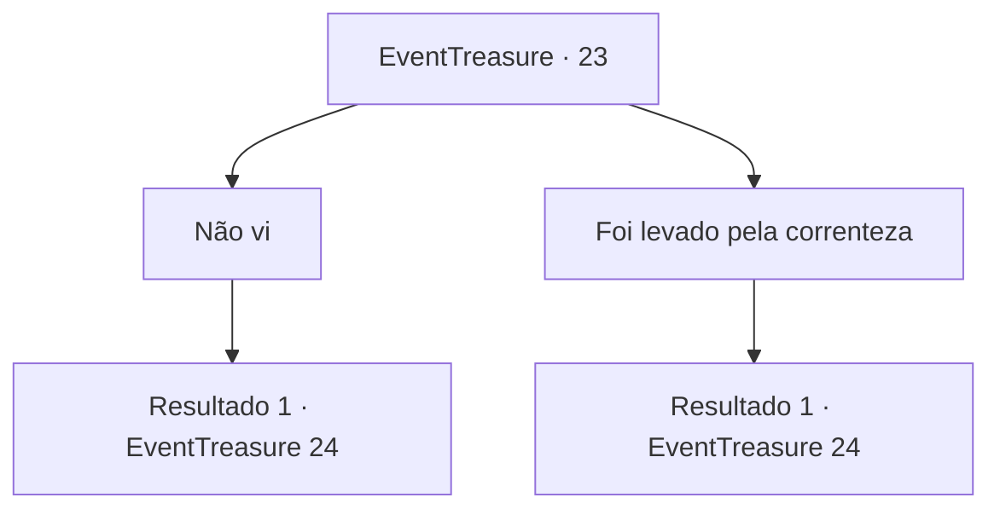

# Eventos de tesouro · 23

[Índice da tabela](index.md) · [Índice geral](../index.md)

ID: `pt:EventTreasure:23` · Fonte: `EventTreasure4` · Versão: 1.2.47.

Mapeamento estático dos arquivos; a disponibilidade e a execução dependem do estado da run.

## Texto do evento

*Sem texto no arquivo.*

## Dados de entrada

```json
{
  "id": 23,
  "grade": 1,
  "place": "",
  "required": ""
}
```

## Mapa das escolhas



## Escolhas e resultados

### Escolha 1

Não vi

Requisitos e outros campos da escolha:

```json
{
  "required": ""
}
```

#### Resultado 1.1

Quando ela ouve sua resposta, ela fica com raiva de você. 

 "Por que você não a pescou? Talvez você tenha roubado!"

 Ela faz uma careta para você e grita para devolver as coisas dela.

Continuação registrada: [Evento 24](0024.md) na mesma tabela.

```json
{
  "required": "",
  "chance": "1",
  "nextEvent": 24,
  "type": 2,
  "reward": ""
}
```

### Escolha 2

Foi levado pela correnteza

Requisitos e outros campos da escolha:

```json
{
  "required": ""
}
```

#### Resultado 2.1

Quando ela ouve sua resposta, ela fica com raiva de você.  

 "Por que você não a pescou? Talvez você tenha roubado!"

  Ela faz uma careta para você e grita para devolver as coisas dela.

Continuação registrada: [Evento 24](0024.md) na mesma tabela.

```json
{
  "required": "",
  "chance": "1",
  "nextEvent": 24,
  "type": 2,
  "reward": ""
}
```

## Referências que chegam a este evento

- [Evento 21 · escolha 2 · resultado 2](0021.md#escolha-2)
- [Evento 21 · escolha 3 · resultado 1](0021.md#escolha-3)
- [Evento 21 · escolha 3 · resultado 3](0021.md#escolha-3)
- [Evento 22 · escolha 1 · resultado 1](0022.md#escolha-1)
- [Evento 22 · escolha 2 · resultado 1](0022.md#escolha-2)
