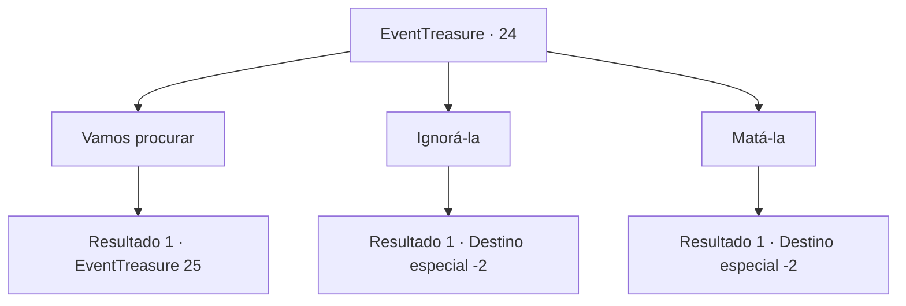

# Eventos de tesouro · 24

[Índice da tabela](index.md) · [Índice geral](../index.md)

ID: `pt:EventTreasure:24` · Fonte: `EventTreasure4` · Versão: 1.2.47.

Mapeamento estático dos arquivos; a disponibilidade e a execução dependem do estado da run.

## Texto do evento

*Sem texto no arquivo.*

## Dados de entrada

```json
{
  "id": 24,
  "grade": 1,
  "place": "",
  "required": ""
}
```

## Mapa das escolhas



## Escolhas e resultados

### Escolha 1

Vamos procurar

Requisitos e outros campos da escolha:

```json
{
  "required": ""
}
```

#### Resultado 1.1

Você segue o riacho para procurar as coisas dela.  Ela não para de reclamar enquanto você caminha.  Você procura até o fim do dia,  mas você não pode encontrar o pacote.  Ela cruza os braços e caminha em sua direção.  

 "Então, o que você vai fazer com as minhas coisas que você perdeu? Você sabe quanto valia isso?"


Continuação registrada: [Evento 25](0025.md) na mesma tabela.

```json
{
  "required": "",
  "chance": "1",
  "nextEvent": 25,
  "type": 2,
  "reward": ""
}
```

### Escolha 2

Ignorá-la

Requisitos e outros campos da escolha:

```json
{
  "required": ""
}
```

#### Resultado 2.1


 "Você...! Eu conheço o seu rosto!"

  Ela grita histericamente enquanto você se afasta.

Continuação registrada: [Destino especial `-2`](../destinos-especiais.md).

```json
{
  "required": "",
  "chance": "1",
  "nextEvent": -2,
  "type": 2,
  "reward": "0_1_-1|5_26_2"
}
```

### Escolha 3

Matá-la

Requisitos e outros campos da escolha:

```json
{
  "required": "2_3_0"
}
```

#### Resultado 3.1

Sua paciência se esgota. Sem saber disso, ela continua gritando com você. Você pega sua arma e bate na cabeça dela. Ela cai de costas no riacho, continuando a jornada, descendo o riacho que transborda.

Continuação registrada: [Destino especial `-2`](../destinos-especiais.md).

```json
{
  "required": "",
  "chance": "1",
  "nextEvent": -2,
  "type": 2,
  "reward": "0_1_1|0_3_-5|5_26_1"
}
```

## Referências que chegam a este evento

- [Evento 23 · escolha 1 · resultado 1](0023.md#escolha-1)
- [Evento 23 · escolha 2 · resultado 1](0023.md#escolha-2)
