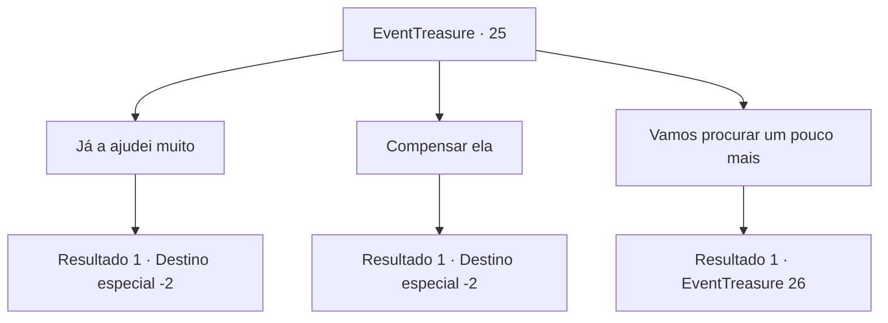

# Eventos de tesouro · 25

[Índice da tabela](index.md) · [Índice geral](../index.md)

ID: `pt:EventTreasure:25` · Fonte: `EventTreasure4` · Versão: 1.2.47.

Mapeamento estático dos arquivos; a disponibilidade e a execução dependem do estado da run.

## Texto do evento

*Sem texto no arquivo.*

## Dados de entrada

```json
{
  "id": 25,
  "grade": 1,
  "place": "",
  "required": ""
}
```

## Mapa das escolhas



## Escolhas e resultados

### Escolha 1

Já a ajudei muito

Requisitos e outros campos da escolha:

```json
{
  "required": ""
}
```

#### Resultado 1.1

Você pensa consigo mesmo que já deu a ela ajuda suficiente e agora ela está apenas perdendo seu tempo.  Quando você diz a ela que não pode mais ajudá-la, ela fica com mais raiva.  

 "Você sabe quem eu sou? Isto é ridículo!"

  Você ignora o discurso dela e começa a se afastar.

Continuação registrada: [Destino especial `-2`](../destinos-especiais.md).

```json
{
  "required": "",
  "chance": "1",
  "nextEvent": -2,
  "type": 2,
  "reward": "0_1_-1|5_26_2"
}
```

### Escolha 2

Compensar ela

Requisitos e outros campos da escolha:

```json
{
  "required": "1_4_100"
}
```

#### Resultado 2.1

Você diz a ela que vai compensá-la por suas coisas.  Ela ainda parece chateada.  

 "Hmpf ... Então me dê 100 de ouro. Não compensa, mas vou deixar pra lá."

  Você dá a ela o ouro. Ela o pega e sai rapidamente.

Continuação registrada: [Destino especial `-2`](../destinos-especiais.md).

```json
{
  "required": "",
  "chance": "1",
  "nextEvent": -2,
  "type": 2,
  "reward": "0_4_-100|0_2_1|5_26_3"
}
```

### Escolha 3

Vamos procurar um pouco mais

Requisitos e outros campos da escolha:

```json
{
  "required": ""
}
```

#### Resultado 3.1

Você decide ajudá-la a procurar um pouco mais.  Ela segue você, reclamando de que as pernas estão doendo.  Ambos seguem a correnteza por muito tempo.  Depois de descer o riacho por um período desconhecido de tempo, você vê uma mochila presa em uma pedra.  

 "É isso!"

  Ela grita, apontando para o pacote.  Como se respondendo à voz dela, Goblins pularam de um arbusto próximo.  Estes não eram Goblins comuns, porque estavam vestidos para matar.  

 "Ahh!! Ki ... mate-os !!"

  Ela grita, encolhendo-se atrás de você.

Continuação registrada: [Evento 26](0026.md) na mesma tabela.

```json
{
  "required": "",
  "chance": "1",
  "nextEvent": 26,
  "type": 2,
  "reward": ""
}
```

## Referências que chegam a este evento

- [Evento 24 · escolha 1 · resultado 1](0024.md#escolha-1)
