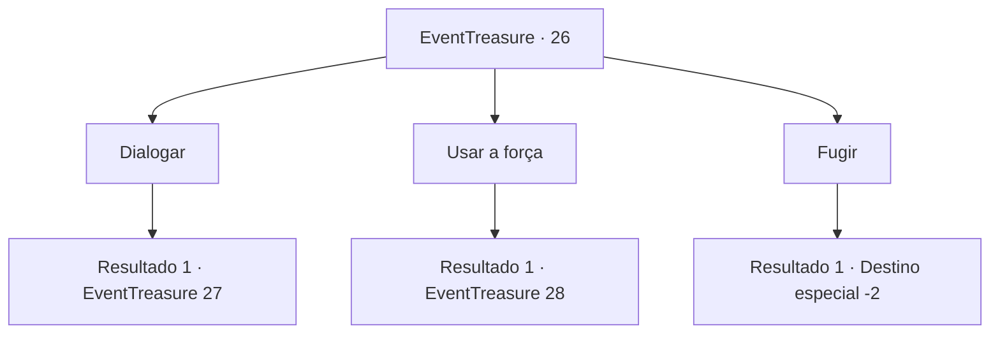

# Eventos de tesouro · 26

[Índice da tabela](index.md) · [Índice geral](../index.md)

ID: `pt:EventTreasure:26` · Fonte: `EventTreasure4` · Versão: 1.2.47.

Mapeamento estático dos arquivos; a disponibilidade e a execução dependem do estado da run.

## Texto do evento

*Sem texto no arquivo.*

## Dados de entrada

```json
{
  "id": 26,
  "grade": 1,
  "place": "",
  "required": ""
}
```

## Mapa das escolhas



## Escolhas e resultados

### Escolha 1

Dialogar

Requisitos e outros campos da escolha:

```json
{
  "required": ""
}
```

#### Resultado 1.1

Você pergunta aos Hobgoblins o que eles querem.  Um deles se adianta para falar.  

 "Você invadiu nosso território. Largue suas coisas e vá embora. Ou pague e leve suas coisas."

  Em seguida, outro ri, acrescentando.  

 "Se você não tem dinheiro, deixe a mulher."

  Os Hobgoblins caíram na gargalhada quando seus olhos ficaram em formato de meia-lua.

Continuação registrada: [Evento 27](0027.md) na mesma tabela.

```json
{
  "required": "",
  "chance": "1",
  "nextEvent": 27,
  "type": 2,
  "reward": ""
}
```

### Escolha 2

Usar a força

Requisitos e outros campos da escolha:

```json
{
  "required": ""
}
```

#### Resultado 2.1

Você pega sua arma. Parece que eles entendem sua intenção.

Continuação registrada: [Evento 28](0028.md) na mesma tabela.

```json
{
  "required": "",
  "chance": "1",
  "nextEvent": 28,
  "type": 2,
  "reward": "6_0_22",
  "place": 1
}
```

### Escolha 3

Fugir

Requisitos e outros campos da escolha:

```json
{
  "required": ""
}
```

#### Resultado 3.1

Você foge deixando a mulher e sua mochila.  Os Goblins não parecem interessados ​​em você.  Eles não vêm atrás de você, então você pode fugir.

Continuação registrada: [Destino especial `-2`](../destinos-especiais.md).

```json
{
  "required": "",
  "chance": "1",
  "nextEvent": -2,
  "type": 2,
  "reward": "5_26_4"
}
```

## Referências que chegam a este evento

- [Evento 25 · escolha 3 · resultado 1](0025.md#escolha-3)
