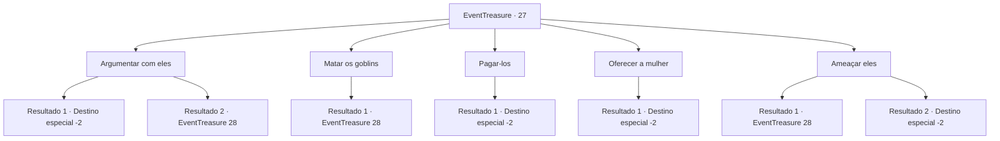

# Eventos de tesouro · 27

[Índice da tabela](index.md) · [Índice geral](../index.md)

ID: `pt:EventTreasure:27` · Fonte: `EventTreasure4` · Versão: 1.2.47.

Mapeamento estático dos arquivos; a disponibilidade e a execução dependem do estado da run.

## Texto do evento

*Sem texto no arquivo.*

## Dados de entrada

```json
{
  "id": 27,
  "grade": 1,
  "place": "",
  "required": ""
}
```

## Mapa das escolhas



## Escolhas e resultados

### Escolha 1

Argumentar com eles

Requisitos e outros campos da escolha:

```json
{
  "required": "1_7_9"
}
```

#### Resultado 1.1

Você usa seu carisma único para convencer os Goblins.  Eles acenam com a cabeça enquanto se afastam.  Você pesca o pacote da fenda da pedra e o entrega à mulher.  

 "* Suspiro ... * Se você não o deixasse flutuar, não teríamos chegado nesta situação. Estou indo embora."

  Ela continua reclamando enquanto desaparece de vista.

Continuação registrada: [Destino especial `-2`](../destinos-especiais.md).

```json
{
  "required": "",
  "chance": "1|0_12_1",
  "nextEvent": -2,
  "type": 0,
  "reward": "0_2_1|5_26_5"
}
```

#### Resultado 1.2

Os Goblins ignoram tudo o que você diz.  Você não consegue convencê-los e eles correm em sua direção com armas em punho.

Continuação registrada: [Evento 28](0028.md) na mesma tabela.

```json
{
  "required": "",
  "chance": "10",
  "nextEvent": 28,
  "type": 1,
  "reward": "6_0_22",
  "place": 1
}
```

### Escolha 2

Matar os goblins

Requisitos e outros campos da escolha:

```json
{
  "required": ""
}
```

#### Resultado 2.1

Você não aceita a oferta dos Goblins.  Então você pega sua arma. Parece que eles entendem sua intenção.

Continuação registrada: [Evento 28](0028.md) na mesma tabela.

```json
{
  "required": "",
  "chance": "1",
  "nextEvent": 28,
  "type": 2,
  "reward": "6_0_22",
  "place": 1
}
```

### Escolha 3

Pagar-los

Requisitos e outros campos da escolha:

```json
{
  "required": "1_4_500"
}
```

#### Resultado 3.1

Você aceita a oferta dos Goblins e paga a quantia que eles pediram.  Os Goblins riem loucamente e pegam o dinheiro.  Em seguida, eles voltam para seu covil.  Você pesca o pacote da fenda da pedra e o entrega à mulher.  

 "* Suspiro ... * Se você não o deixasse flutuar, não teríamos chegado nesta situação. Estou indo embora."

  Ela continua reclamando enquanto desaparece de vista.

Continuação registrada: [Destino especial `-2`](../destinos-especiais.md).

```json
{
  "required": "",
  "chance": "1",
  "nextEvent": -2,
  "type": 2,
  "reward": "5_26_5|0_4_-500|0_2_1"
}
```

### Escolha 4

Oferecer a mulher

Requisitos e outros campos da escolha:

```json
{
  "required": "2_3_0"
}
```

#### Resultado 4.1

Você aceita a oferta dos Goblins e diz a eles para aceitarem a mulher.  Tirada de sua guarda, ela grita.  

 "O que você disse?! Você ... você está louco?"

  Os Goblins riem e cercam a mulher.  Eles a amarram e a levam de volta ao covil.  Você pesca o pacote da fenda da rocha.  Dentro você encontrou peças de roupa, uma pequena quantia em dinheiro e um livro.  Você coloca os pertences em sua bolsa e continua sua jornada.

Continuação registrada: [Destino especial `-2`](../destinos-especiais.md).

```json
{
  "required": "",
  "chance": "1",
  "nextEvent": -2,
  "type": 2,
  "reward": "0_4_3|3_51_1|5_26_4|0_2_1"
}
```

### Escolha 5

Ameaçar eles

Requisitos e outros campos da escolha:

```json
{
  "required": ""
}
```

#### Resultado 5.1

Você ameaça os Goblins, mas eles apenas zombam e sacam suas armas.

Continuação registrada: [Evento 28](0028.md) na mesma tabela.

```json
{
  "required": "",
  "chance": "10",
  "nextEvent": 28,
  "type": 1,
  "reward": "6_0_22",
  "place": 1
}
```

#### Resultado 5.2

Com medo de sua ameaça, os Goblins fugiram.  Você pescou o pacote da fenda da rocha e o entregou à mulher.  

 "* Suspiro ... * Se você não o deixasse flutuar, não teríamos chegado nesta situação. Estou indo embora."

  Ela continua reclamando enquanto desaparece de vista.

Continuação registrada: [Destino especial `-2`](../destinos-especiais.md).

```json
{
  "required": "",
  "chance": "1|0_12_1",
  "nextEvent": -2,
  "type": 0,
  "reward": ""
}
```

## Referências que chegam a este evento

- [Evento 26 · escolha 1 · resultado 1](0026.md#escolha-1)
