# Eventos de tesouro · 29

[Índice da tabela](index.md) · [Índice geral](../index.md)

ID: `pt:EventTreasure:29` · Fonte: `EventTreasure4` · Versão: 1.2.47.

Mapeamento estático dos arquivos; a disponibilidade e a execução dependem do estado da run.

## Texto do evento

Você está andando na beira da praia, ouvindo o barulho das ondas. E então, você nota um barco encalhado. |drawing_sinkboat| Ele provavelmente bateu num recife de coral quando foi tragado por uma onda forte.

## Dados de entrada

```json
{
  "id": 29,
  "grade": 1,
  "place": "",
  "required": ""
}
```

## Mapa das escolhas

```mermaid
flowchart TD
  E["EventTreasure · 29"]
  C0["Nadar até o barco"]
  E --> C0
  R0_0["Resultado 1 · Destino especial -2"]
  C0 --> R0_0
  R0_1["Resultado 2 · Destino especial -3"]
  C0 --> R0_1
  R0_2["Resultado 3 · Destino especial -2"]
  C0 --> R0_2
  R0_3["Resultado 4 · Destino especial -2"]
  C0 --> R0_3
  R0_4["Resultado 5 · Destino especial -2"]
  C0 --> R0_4
  C1["Surfar"]
  E --> C1
  R1_0["Resultado 1 · Destino especial -2"]
  C1 --> R1_0
  R1_1["Resultado 2 · Destino especial -3"]
  C1 --> R1_1
  R1_2["Resultado 3 · Destino especial -2"]
  C1 --> R1_2
  R1_3["Resultado 4 · Destino especial -2"]
  C1 --> R1_3
  R1_4["Resultado 5 · Destino especial -2"]
  C1 --> R1_4
  R1_5["Resultado 6 · Destino especial -2"]
  C1 --> R1_5
  R1_6["Resultado 7 · Destino especial -3"]
  C1 --> R1_6
  R1_7["Resultado 8 · Destino especial -2"]
  C1 --> R1_7
  R1_8["Resultado 9 · Destino especial -2"]
  C1 --> R1_8
  R1_9["Resultado 10 · Destino especial -2"]
  C1 --> R1_9
  R1_10["Resultado 11 · Destino especial -2"]
  C1 --> R1_10
  C2["Ignorar"]
  E --> C2
  R2_0["Resultado 1 · Destino especial -2"]
  C2 --> R2_0
```



## Escolhas e resultados

### Escolha 1

Nadar até o barco

Requisitos e outros campos da escolha:

```json
{
  "required": "1_0_2"
}
```

#### Resultado 1.1

Você pula no oceano e nada freneticamente.  Mas você não é capaz de fazer isso lá.  Logo, sem forças, você volta para a costa.

Continuação registrada: [Destino especial `-2`](../destinos-especiais.md).

```json
{
  "required": "1_0_2",
  "chance": "50",
  "nextEvent": -2,
  "type": 1,
  "reward": "0_0_-1"
}
```

#### Resultado 1.2

Você pula no oceano e nada freneticamente.  Mas você não é capaz de fazer isso lá.  Logo, sem forças, você volta para a costa.

Continuação registrada: [Destino especial `-3`](../destinos-especiais.md).

```json
{
  "required": "2_0_2",
  "chance": "80",
  "nextEvent": -3,
  "type": 1,
  "reward": "0_0_-1"
}
```

#### Resultado 1.3

Você pula no oceano e nada freneticamente.  Você consegue chegar ao navio.  Dentro, você encontra uma caixa molhada.  Ela contém um punhado de moedas de ouro e um porrete em surpreendente bom estado.  Você reúne os itens e nada de volta à costa.

Continuação registrada: [Destino especial `-2`](../destinos-especiais.md).

```json
{
  "required": "",
  "chance": "1|0_5_3",
  "nextEvent": -2,
  "type": 0,
  "reward": "0_4_10|3_62_1|0_2_1"
}
```

#### Resultado 1.4

Você pula no oceano e nada freneticamente.  Você consegue chegar ao navio.  Dentro, você encontra uma caixa molhada.  Está cheio de ouro.  Você recolhe tudo e nada de volta à costa.

Continuação registrada: [Destino especial `-2`](../destinos-especiais.md).

```json
{
  "required": "",
  "chance": "1|0_5_2",
  "nextEvent": -2,
  "type": 0,
  "reward": "0_4_100|0_2_1"
}
```

#### Resultado 1.5

Você pula no oceano e nada freneticamente.  Você consegue chegar ao navio.  Dentro, você encontra um longo tridente.  Você o pega e nada de volta para a costa.

Continuação registrada: [Destino especial `-2`](../destinos-especiais.md).

```json
{
  "required": "",
  "chance": "1|0_5_1",
  "nextEvent": -2,
  "type": 0,
  "reward": "3_17_1|0_2_1"
}
```

### Escolha 2

Surfar

Requisitos e outros campos da escolha:

```json
{
  "required": ""
}
```

#### Resultado 2.1

Você tenta cavalgar 'Prydwen' todo o caminho até o navio. Mas você não consegue manter o equilíbrio. As ondas o empurram para trás e você nada de volta para a costa com a boca cheia de água do mar.

Continuação registrada: [Destino especial `-2`](../destinos-especiais.md).

```json
{
  "required": "1_0_2|8_95_1",
  "chance": "11",
  "nextEvent": -2,
  "type": 1,
  "reward": "0_0_-1"
}
```

#### Resultado 2.2

Você tenta cavalgar 'Prydwen' todo o caminho até o navio.  Mas você não consegue manter o equilíbrio.  As ondas o empurram para trás e você nada de volta para a costa com a boca cheia de água do mar.

Continuação registrada: [Destino especial `-3`](../destinos-especiais.md).

```json
{
  "required": "2_0_2|8_95_1",
  "chance": "11",
  "nextEvent": -3,
  "type": 1,
  "reward": "0_0_-1"
}
```

#### Resultado 2.3

Você nada com sucesso 'Prydwen' todo o caminho até o navio. Dentro, você encontra uma caixa molhada. Ele contém um punhado de moedas de ouro e um porrete em surpreendente bom estado. Você reúne os itens e nada de volta à costa.

Continuação registrada: [Destino especial `-2`](../destinos-especiais.md).

```json
{
  "required": "8_95_1",
  "chance": "1|0_6_2",
  "nextEvent": -2,
  "type": 0,
  "reward": "0_4_10|3_62_1|0_2_1"
}
```

#### Resultado 2.4

Você nada com sucesso 'Prydwen' todo o caminho até o navio. Você consegue chegar ao navio. Dentro, você encontra uma caixa molhada. Está cheia de ouro. Você coleta tudo isso e nada de volta à costa.

Continuação registrada: [Destino especial `-2`](../destinos-especiais.md).

```json
{
  "required": "8_95_1",
  "chance": "1|0_6_1",
  "nextEvent": -2,
  "type": 0,
  "reward": "0_4_100|0_2_1"
}
```

#### Resultado 2.5

Você nada com sucesso 'Prydwen' todo o caminho até o navio. Você consegue chegar ao navio. Dentro, você encontra um longo tridente. Você pega ele e nada de volta à costa.

Continuação registrada: [Destino especial `-2`](../destinos-especiais.md).

```json
{
  "required": "8_95_1",
  "chance": "1|0_6_1",
  "nextEvent": -2,
  "type": 0,
  "reward": "3_17_1|0_2_1"
}
```

#### Resultado 2.6

Você tenta cavalgar 'Chifre do Mar' todo o caminho até o navio. Mas você não consegue manter o equilíbrio. As ondas o empurram para trás e você nada de volta para a costa com a boca cheia de água do mar.

Continuação registrada: [Destino especial `-2`](../destinos-especiais.md).

```json
{
  "required": "1_0_2|8_214_1",
  "chance": "11",
  "nextEvent": -2,
  "type": 1,
  "reward": "0_0_-1"
}
```

#### Resultado 2.7

Você tenta cavalgar 'Chifre do Mar' todo o caminho até o navio.  Mas você não consegue manter o equilíbrio.  As ondas o empurram para trás e você nada de volta para a costa com a boca cheia de água do mar.

Continuação registrada: [Destino especial `-3`](../destinos-especiais.md).

```json
{
  "required": "2_0_2|8_214_1",
  "chance": "11",
  "nextEvent": -3,
  "type": 1,
  "reward": "0_0_-1"
}
```

#### Resultado 2.8

Você montou com sucesso 'Chifre do Mar' todo o caminho até o navio.  Dentro, você encontra uma caixa molhada.  Ela contém um punhado de moedas de ouro e um porrete em surpreendente bom estado.  Você reúne os itens e nada de volta à costa.

Continuação registrada: [Destino especial `-2`](../destinos-especiais.md).

```json
{
  "required": "8_214_1",
  "chance": "1|0_6_2",
  "nextEvent": -2,
  "type": 0,
  "reward": "0_4_10|3_62_1|0_2_1"
}
```

#### Resultado 2.9

Você montou com sucesso 'Chifre do Mar' todo o caminho até o navio.  Você consegue chegar ao navio.  Dentro, você encontra uma caixa molhada.  Está cheia de ouro.  Você coleta tudo e nada de volta à costa.

Continuação registrada: [Destino especial `-2`](../destinos-especiais.md).

```json
{
  "required": "8_214_1",
  "chance": "1|0_6_1",
  "nextEvent": -2,
  "type": 0,
  "reward": "0_4_100|0_2_1"
}
```

#### Resultado 2.10

  Você montou com sucesso 'Chifre do Mar' todo o caminho até o navio.  Você consegue chegar ao navio.  Dentro, você encontra um longo tridente.  Você o pega e nada de volta à costa.

Continuação registrada: [Destino especial `-2`](../destinos-especiais.md).

```json
{
  "required": "8_214_1",
  "chance": "1|0_6_1",
  "nextEvent": -2,
  "type": 0,
  "reward": "3_17_1|0_2_1"
}
```

#### Resultado 2.11

Você se pergunta como seria surfar nas ondas, mas não havia um caminho adequado, então você se vira.

Continuação registrada: [Destino especial `-2`](../destinos-especiais.md).

```json
{
  "required": "10_214_1|10_95_1",
  "chance": "1",
  "nextEvent": -2,
  "type": 2,
  "reward": ""
}
```

### Escolha 3

Ignorar

Requisitos e outros campos da escolha:

```json
{
  "required": ""
}
```

#### Resultado 3.1

Você não quer que suas roupas toquem a água salgada, então continua seu caminho.

Continuação registrada: [Destino especial `-2`](../destinos-especiais.md).

```json
{
  "required": "",
  "chance": "1",
  "nextEvent": -2,
  "type": 2,
  "reward": ""
}
```

## Referências que chegam a este evento

Nenhum `nextEvent` positivo da mesma tabela aponta para este nó. Isso não prova que seja inacessível: sorteio e estado de história podem selecioná-lo.

