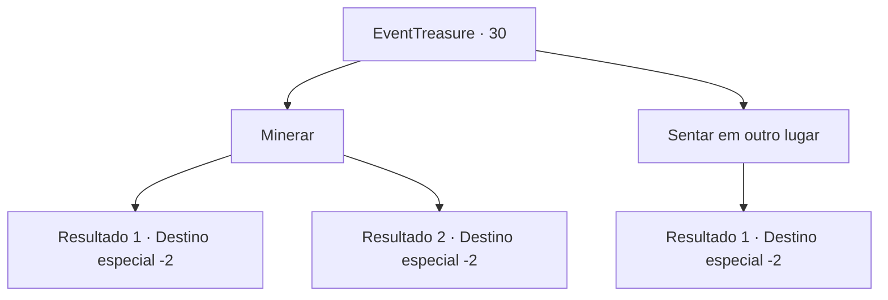

# Eventos de tesouro · 30

[Índice da tabela](index.md) · [Índice geral](../index.md)

ID: `pt:EventTreasure:30` · Fonte: `EventTreasure4` · Versão: 1.2.47.

Mapeamento estático dos arquivos; a disponibilidade e a execução dependem do estado da run.

## Texto do evento

Você senta numa pilha de folhas para fazer uma breve pausa. Mas enquanto descansa, você sente uma superfície dura embaixo. Você afasta as folhas para o lado, encontrando uma rocha de aparência incomum.

## Dados de entrada

```json
{
  "id": 30,
  "grade": 1,
  "place": "",
  "required": "5_625_0"
}
```

## Mapa das escolhas



## Escolhas e resultados

### Escolha 1

Minerar

Requisitos e outros campos da escolha:

```json
{
  "required": "8_44_1"
}
```

#### Resultado 1.1

Você pega uma picareta e bate contra a rocha. A picareta quebra após alguns golpes, então você só consegue coletar restos de cobre.

Continuação registrada: [Destino especial `-2`](../destinos-especiais.md).

```json
{
  "required": "",
  "chance": "7",
  "nextEvent": -2,
  "type": 1,
  "reward": "3_126_1|4_44_1|5_625_1"
}
```

#### Resultado 1.2

Você pega uma picareta e bate contra a rocha.  Ela quebra após algumas batidas, revelando pedaços de cobre.  Um comerciante pagará generosamente por eles. Você coleta os pedaços.

Continuação registrada: [Destino especial `-2`](../destinos-especiais.md).

```json
{
  "required": "",
  "chance": "1|0_5_1",
  "nextEvent": -2,
  "type": 0,
  "reward": "3_126_5|0_2_1|5_625_1"
}
```

### Escolha 2

Sentar em outro lugar

Requisitos e outros campos da escolha:

```json
{
  "required": ""
}
```

#### Resultado 2.1

Você tateia o caminho através das folhas e encontra um lugar mais macio para se sentar e fazer uma pausa.

Continuação registrada: [Destino especial `-2`](../destinos-especiais.md).

```json
{
  "required": "",
  "chance": "1",
  "nextEvent": -2,
  "type": 2,
  "reward": "0_0_1|0_2_1|5_625_1"
}
```

## Referências que chegam a este evento

Nenhum `nextEvent` positivo da mesma tabela aponta para este nó. Isso não prova que seja inacessível: sorteio e estado de história podem selecioná-lo.

