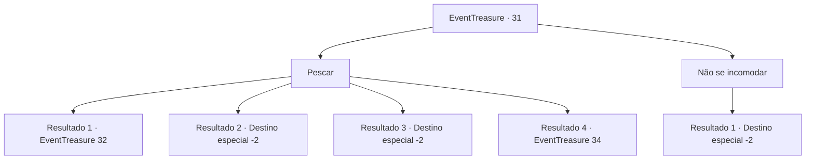

# Eventos de tesouro · 31

[Índice da tabela](index.md) · [Índice geral](../index.md)

ID: `pt:EventTreasure:31` · Fonte: `EventTreasure4` · Versão: 1.2.47.

Mapeamento estático dos arquivos; a disponibilidade e a execução dependem do estado da run.

## Texto do evento

Você está andando por uma praia com as pedras estranhamente espalhadas. Você observa e conclui que podia pescar um pouco aqui.

## Dados de entrada

```json
{
  "id": 31,
  "grade": 1,
  "place": "",
  "required": "8_43_1"
}
```

## Mapa das escolhas



## Escolhas e resultados

### Escolha 1

Pescar

Requisitos e outros campos da escolha:

```json
{
  "required": "8_43_1"
}
```

#### Resultado 1.1

Algum tempo depois de começar a pescar,  algo puxa a vara inteira para a água.  Você pega bem a tempo, com ela dobrando como se estivesse prestes a quebrar.

Continuação registrada: [Evento 32](0032.md) na mesma tabela.

```json
{
  "required": "",
  "chance": "1",
  "nextEvent": 32,
  "type": 2,
  "reward": ""
}
```

#### Resultado 1.2

Algum tempo depois de começar a pescar, sua boia de pesca desaparece na água. Você rapidamente agarra a vara e puxa um pequeno peixe. Você o pega e continua sua jornada.

Continuação registrada: [Destino especial `-2`](../destinos-especiais.md).

```json
{
  "required": "",
  "chance": "4",
  "nextEvent": -2,
  "type": 2,
  "reward": "0_1_1|3_124_1|0_2_1"
}
```

#### Resultado 1.3

Você não consegue pegar nada.  Você guarda sua vara de pescar e continua sua jornada.

Continuação registrada: [Destino especial `-2`](../destinos-especiais.md).

```json
{
  "required": "",
  "chance": "4",
  "nextEvent": -2,
  "type": 2,
  "reward": ""
}
```

#### Resultado 1.4

Horas se passam depois que você começa a pescar.  Você está prestes a desistir quando algo salta da água.  É muito grande para ser um peixe.  Ele abre as mandíbulas de leão e avança em sua direção.

Continuação registrada: [Evento 34](0034.md) na mesma tabela.

```json
{
  "required": "",
  "chance": "1",
  "nextEvent": 34,
  "type": 2,
  "reward": "6_0_44",
  "place": 8
}
```

### Escolha 2

Não se incomodar

Requisitos e outros campos da escolha:

```json
{
  "required": ""
}
```

#### Resultado 2.1

Você decide não pescar.

Continuação registrada: [Destino especial `-2`](../destinos-especiais.md).

```json
{
  "required": "",
  "chance": "1",
  "nextEvent": -2,
  "type": 2,
  "reward": ""
}
```

## Referências que chegam a este evento

Nenhum `nextEvent` positivo da mesma tabela aponta para este nó. Isso não prova que seja inacessível: sorteio e estado de história podem selecioná-lo.

