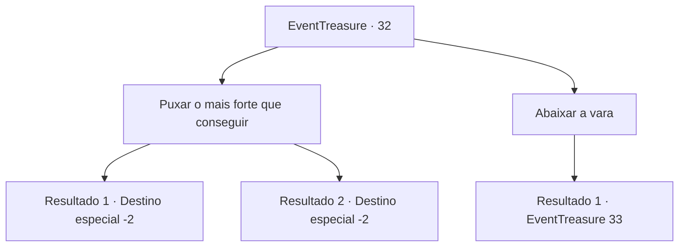

# Eventos de tesouro · 32

[Índice da tabela](index.md) · [Índice geral](../index.md)

ID: `pt:EventTreasure:32` · Fonte: `EventTreasure4` · Versão: 1.2.47.

Mapeamento estático dos arquivos; a disponibilidade e a execução dependem do estado da run.

## Texto do evento

*Sem texto no arquivo.*

## Dados de entrada

```json
{
  "id": 32,
  "grade": 1,
  "place": "",
  "required": ""
}
```

## Mapa das escolhas



## Escolhas e resultados

### Escolha 1

Puxar o mais forte que conseguir

Requisitos e outros campos da escolha:

```json
{
  "required": ""
}
```

#### Resultado 1.1

Você puxa a vara com todas as suas forças.
  <link=shake>CRAAACK!</link>
  A haste se parte em muitos estilhaços e desaparece no oceano.  Você olha com desânimo para o que resta do cabo.  Você não tem escolha a não ser jogá-lo fora.

Continuação registrada: [Destino especial `-2`](../destinos-especiais.md).

```json
{
  "required": "",
  "chance": "11",
  "nextEvent": -2,
  "type": 1,
  "reward": "4_43_1"
}
```

#### Resultado 1.2

Você puxa a vara com todas as suas forças.
  <link=shake>CRAAACK!</link>
  A vara está prestes a se partir, mas você agarra a linha de pesca e continua puxando.  Você puxa com sucesso um peixe gigante usando seus braços incrivelmente poderosos.  Você pega o peixe e continua sua jornada com prazer.

Continuação registrada: [Destino especial `-2`](../destinos-especiais.md).

```json
{
  "required": "",
  "chance": "1|0_5_1",
  "nextEvent": -2,
  "type": 0,
  "reward": "3_125_1|0_1_1|0_2_1"
}
```

### Escolha 2

Abaixar a vara

Requisitos e outros campos da escolha:

```json
{
  "required": ""
}
```

#### Resultado 2.1

Você abaixa ligeiramente a ponta da vara.
  Ela continua a se dobrar para dentro,  mas não o suficiente para quebrar.  Logo, o peixe para de resistir.

Continuação registrada: [Evento 33](0033.md) na mesma tabela.

```json
{
  "required": "",
  "chance": "1",
  "nextEvent": 33,
  "type": 2,
  "reward": ""
}
```

## Referências que chegam a este evento

- [Evento 31 · escolha 1 · resultado 1](0031.md#escolha-1)
