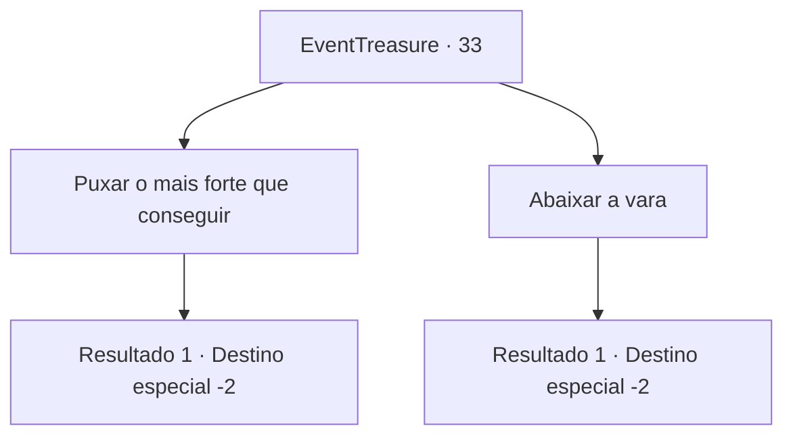

# Eventos de tesouro · 33

[Índice da tabela](index.md) · [Índice geral](../index.md)

ID: `pt:EventTreasure:33` · Fonte: `EventTreasure4` · Versão: 1.2.47.

Mapeamento estático dos arquivos; a disponibilidade e a execução dependem do estado da run.

## Texto do evento

*Sem texto no arquivo.*

## Dados de entrada

```json
{
  "id": 33,
  "grade": 1,
  "place": "",
  "required": ""
}
```

## Mapa das escolhas



## Escolhas e resultados

### Escolha 1

Puxar o mais forte que conseguir

Requisitos e outros campos da escolha:

```json
{
  "required": ""
}
```

#### Resultado 1.1

Você puxa a vara com todas as suas forças.
  Um peixe gigante sai voando. Você pode sentir o peso através do cabo.  Você pega o peixe e continua sua jornada com prazer.

Continuação registrada: [Destino especial `-2`](../destinos-especiais.md).

```json
{
  "required": "",
  "chance": "1",
  "nextEvent": -2,
  "type": 2,
  "reward": "3_125_1|0_1_1|0_2_1"
}
```

### Escolha 2

Abaixar a vara

Requisitos e outros campos da escolha:

```json
{
  "required": ""
}
```

#### Resultado 2.1

Você abaixa ligeiramente a ponta da vara.  De repente, a tensão desaparece.  Você puxa e não tem nada no anzol.  Você perde o interesse, guarda a vara e continua sua jornada.

Continuação registrada: [Destino especial `-2`](../destinos-especiais.md).

```json
{
  "required": "",
  "chance": "1",
  "nextEvent": -2,
  "type": 2,
  "reward": ""
}
```

## Referências que chegam a este evento

- [Evento 32 · escolha 2 · resultado 1](0032.md#escolha-2)
