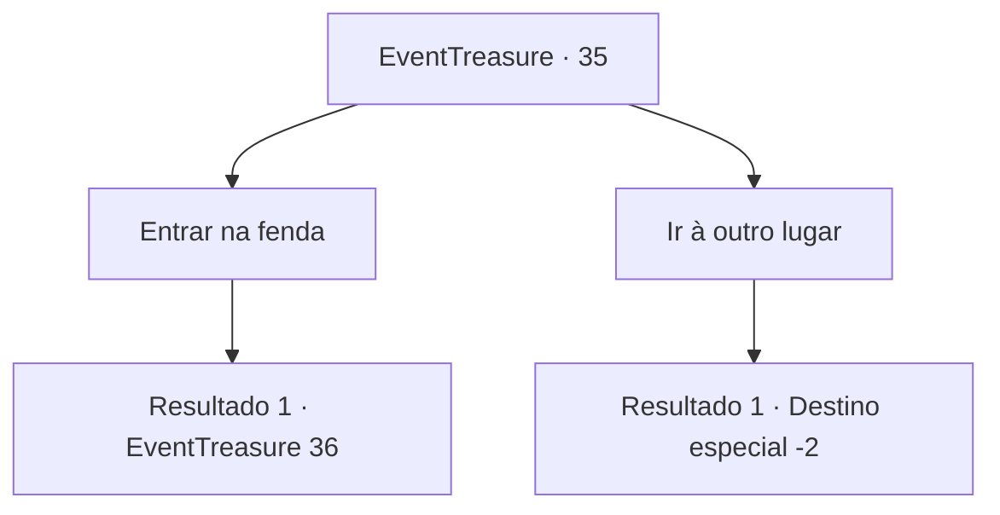

# Eventos de tesouro · 35

[Índice da tabela](index.md) · [Índice geral](../index.md)

ID: `pt:EventTreasure:35` · Fonte: `EventTreasure4` · Versão: 1.2.47.

Mapeamento estático dos arquivos; a disponibilidade e a execução dependem do estado da run.

## Texto do evento

Você acha uma pequena fenda saindo um feixe de luz nas montanhas rochosas. Você espreita e descobre que a luz vem de uma mina. Mas parece que não há ninguém dentro, parecendo abandonada.

## Dados de entrada

```json
{
  "id": 35,
  "grade": 1,
  "place": "",
  "required": "5_59_0|18_94_5|18_94_4|18_94_3|1_2_30|5_94_0"
}
```

## Mapa das escolhas



## Escolhas e resultados

### Escolha 1

Entrar na fenda

Requisitos e outros campos da escolha:

```json
{
  "required": ""
}
```

#### Resultado 1.1

|drawing_mine| Você se enfia na fenda e sente o calor da mina. É bem iluminada por dentro, o que significa que alguém a estava usando recentemente. Você pega uma picareta e começa a viajar pelas profundezas do túnel. 

 Algum tempo depois, você percebe que uma figura está vindo em sua direção segurando uma tocha. A julgar pelo som que faz e pela forma de sua silhueta, você pode dizer que não é um humano.

Continuação registrada: [Evento 36](0036.md) na mesma tabela.

```json
{
  "required": "",
  "chance": "1",
  "nextEvent": 36,
  "type": 2,
  "reward": "3_44_1|0_2_1|5_59_9"
}
```

### Escolha 2

Ir à outro lugar

Requisitos e outros campos da escolha:

```json
{
  "required": ""
}
```

#### Resultado 2.1

Você passa pela fenda e segue em frente.

Continuação registrada: [Destino especial `-2`](../destinos-especiais.md).

```json
{
  "required": "",
  "chance": "1",
  "nextEvent": -2,
  "type": 2,
  "reward": ""
}
```

## Referências que chegam a este evento

Nenhum `nextEvent` positivo da mesma tabela aponta para este nó. Isso não prova que seja inacessível: sorteio e estado de história podem selecioná-lo.

