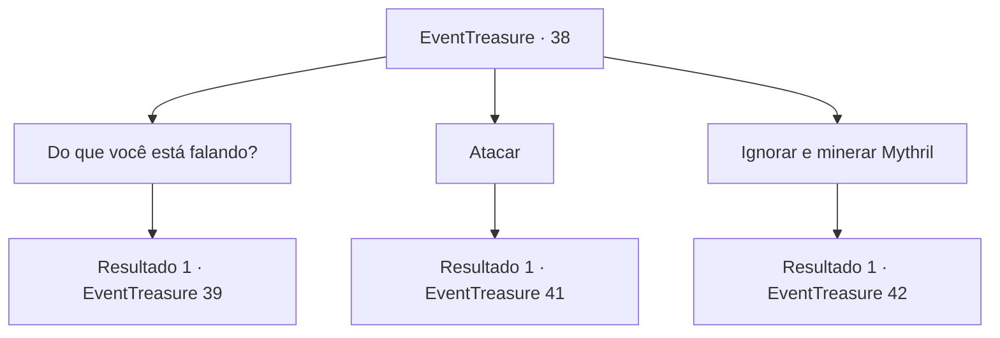

# Eventos de tesouro · 38

[Índice da tabela](index.md) · [Índice geral](../index.md)

ID: `pt:EventTreasure:38` · Fonte: `EventTreasure4` · Versão: 1.2.47.

Mapeamento estático dos arquivos; a disponibilidade e a execução dependem do estado da run.

## Texto do evento

*Sem texto no arquivo.*

## Dados de entrada

```json
{
  "id": 38,
  "grade": 1,
  "place": "",
  "required": ""
}
```

## Mapa das escolhas



## Escolhas e resultados

### Escolha 1

Do que você está falando?

Requisitos e outros campos da escolha:

```json
{
  "required": ""
}
```

#### Resultado 1.1

Você pergunta ao corvo o que isso significa.  Ele começa a explicar.  

 "Esta mina aqui é propriedade do Grande Balor, então o que quero dizer é, dê o fora."

  Ele coça as penas com o bico e continua.  

 "Mas eu posso reconsiderar se você me der nove décimos desse minério Mythril."


Continuação registrada: [Evento 39](0039.md) na mesma tabela.

```json
{
  "required": "",
  "chance": "1",
  "nextEvent": 39,
  "type": 2,
  "reward": ""
}
```

### Escolha 2

Atacar

Requisitos e outros campos da escolha:

```json
{
  "required": ""
}
```

#### Resultado 2.1

Você bate no corvo.  Ele cai no chão e muda de forma conforme se levanta.  

 "Então é assim que vai ser ..."

  Acontece que não é um corvo, mas um diabinho disfarçado.  Ele furiosamente tenta espetá-lo com uma lança.

Continuação registrada: [Evento 41](0041.md) na mesma tabela.

```json
{
  "required": "",
  "chance": "1",
  "nextEvent": 41,
  "type": 2,
  "reward": "6_2_68",
  "place": 6
}
```

### Escolha 3

Ignorar e minerar Mythril

Requisitos e outros campos da escolha:

```json
{
  "required": ""
}
```

#### Resultado 3.1

Você ignora o corvo e continua minerando. Ele grasna e bate as asas com raiva. <link=wave><color=red>

 "KAW ... KAW ... KAW ..."

</color> </link> O som dos grito dele abala toda a mina. O calor irradia por dentro das paredes. Antes que você possa correr, uma criatura gigante emerge do solo. Ela tem chifres gigantes e segura uma espada em uma mão e um chicote flamejante na outra. É o Balor. |drawing_balor|

Continuação registrada: [Evento 42](0042.md) na mesma tabela.

```json
{
  "required": "",
  "chance": "1",
  "nextEvent": 42,
  "type": 2,
  "reward": "6_0_69",
  "place": 6
}
```

## Referências que chegam a este evento

- [Evento 36 · escolha 1 · resultado 2](0036.md#escolha-1)
- [Evento 36 · escolha 2 · resultado 2](0036.md#escolha-2)
- [Evento 36 · escolha 3 · resultado 2](0036.md#escolha-3)
- [Evento 37 · escolha 1 · resultado 1](0037.md#escolha-1)
