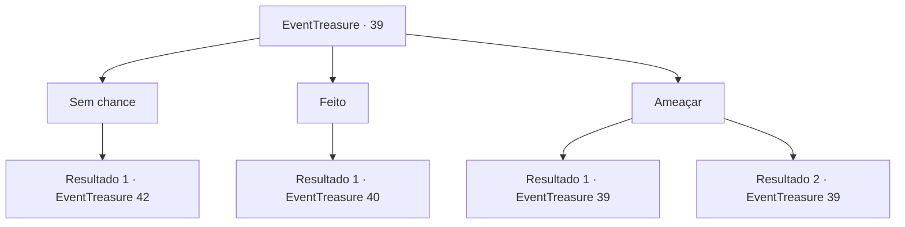

# Eventos de tesouro · 39

[Índice da tabela](index.md) · [Índice geral](../index.md)

ID: `pt:EventTreasure:39` · Fonte: `EventTreasure4` · Versão: 1.2.47.

Mapeamento estático dos arquivos; a disponibilidade e a execução dependem do estado da run.

## Texto do evento

*Sem texto no arquivo.*

## Dados de entrada

```json
{
  "id": 39,
  "grade": 1,
  "place": "",
  "required": ""
}
```

## Mapa das escolhas



## Escolhas e resultados

### Escolha 1

Sem chance

Requisitos e outros campos da escolha:

```json
{
  "required": ""
}
```

#### Resultado 1.1

Você ignora o corvo e continua minerando.  Ele grasna e bate as asas com raiva.  <link=wave><color=red>

 "KAW ... KAW ... KAW ..."

</color> </link>  O som dos grito dele abala toda a mina.  O calor irradia por dentro das paredes.  Antes que você possa correr, uma criatura gigante emerge do solo.  Ela tem chifres gigantes e segura uma espada em uma mão e um chicote flamejante na outra.  É o Balor.  |drawing_balor|

Continuação registrada: [Evento 42](0042.md) na mesma tabela.

```json
{
  "required": "",
  "chance": "1",
  "nextEvent": 42,
  "type": 2,
  "reward": "6_0_69",
  "place": 6
}
```

### Escolha 2

Feito

Requisitos e outros campos da escolha:

```json
{
  "required": ""
}
```

#### Resultado 2.1

Você aceita os termos do corvo.  Ele circunda você enquanto você extrai o Mythril.  

  É escaldante,  e logo você está coberto de suor.  Depois de terminar, o corvo se transforma em um diabinho.  

 "Bom trabalho!"


Continuação registrada: [Evento 40](0040.md) na mesma tabela.

```json
{
  "required": "",
  "chance": "1",
  "nextEvent": 40,
  "type": 2,
  "reward": ""
}
```

### Escolha 3

Ameaçar

Requisitos e outros campos da escolha:

```json
{
  "required": "5_58_0"
}
```

#### Resultado 3.1

Você olha para o corvo com desprezo. Ele responde sarcasticamente. <link=wave>

 "Bem, fique à vontade. Mas você nunca sairá inteiro com isso."

</link> Ele acrescenta que você só pode adquirir o Mythril com segurança com a ajuda dele.

Continuação registrada: [Evento 39](0039.md) na mesma tabela.

```json
{
  "required": "",
  "chance": "15",
  "nextEvent": 39,
  "type": 1,
  "reward": "5_58_1"
}
```

#### Resultado 3.2

Você olha para o corvo com desprezo.  Ele fica um pouco intimidado.  

 "Uh ... que tal apenas a metade?"


Continuação registrada: [Evento 39](0039.md) na mesma tabela.

```json
{
  "required": "",
  "chance": "1|0_12_1",
  "nextEvent": 39,
  "type": 0,
  "reward": "5_58_2"
}
```

## Referências que chegam a este evento

- [Evento 38 · escolha 1 · resultado 1](0038.md#escolha-1)
- [Evento 39 · escolha 3 · resultado 1](0039.md#escolha-3)
- [Evento 39 · escolha 3 · resultado 2](0039.md#escolha-3)
