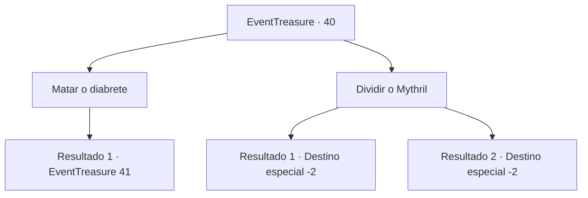

# Eventos de tesouro · 40

[Índice da tabela](index.md) · [Índice geral](../index.md)

ID: `pt:EventTreasure:40` · Fonte: `EventTreasure4` · Versão: 1.2.47.

Mapeamento estático dos arquivos; a disponibilidade e a execução dependem do estado da run.

## Texto do evento

*Sem texto no arquivo.*

## Dados de entrada

```json
{
  "id": 40,
  "grade": 1,
  "place": "",
  "required": ""
}
```

## Mapa das escolhas



## Escolhas e resultados

### Escolha 1

Matar o diabrete

Requisitos e outros campos da escolha:

```json
{
  "required": ""
}
```

#### Resultado 1.1

Você decide reivindicar todo o Mythril para você. Mas no momento em que você pega sua arma, o diabinho pega uma lança. <link=shake>

 "Hehehe, sabia que faria isso, seu demônio imundo."

</link>

Continuação registrada: [Evento 41](0041.md) na mesma tabela.

```json
{
  "required": "",
  "chance": "1",
  "nextEvent": 41,
  "type": 2,
  "reward": "6_0_68|0_3_-1",
  "place": 6
}
```

### Escolha 2

Dividir o Mythril

Requisitos e outros campos da escolha:

```json
{
  "required": ""
}
```

#### Resultado 2.1

Você dividiu o minério Mythril com o diabinho como prometeu. Ele ri e voa com a parte dele. Você pega sua parte miserável e vai embora.

Continuação registrada: [Destino especial `-2`](../destinos-especiais.md).

```json
{
  "required": "18_58_2",
  "chance": "1",
  "nextEvent": -2,
  "type": 2,
  "reward": "0_2_1|3_128_1|5_59_9"
}
```

#### Resultado 2.2

Você dividiu o minério Mythril com o diabinho como prometeu.  Ele ri e voa com a parte dele.  Você pega sua parte miserável e vai embora.

Continuação registrada: [Destino especial `-2`](../destinos-especiais.md).

```json
{
  "required": "5_58_2",
  "chance": "1",
  "nextEvent": -2,
  "type": 2,
  "reward": "0_2_1|3_129_1|5_59_9"
}
```

## Referências que chegam a este evento

- [Evento 39 · escolha 2 · resultado 1](0039.md#escolha-2)
