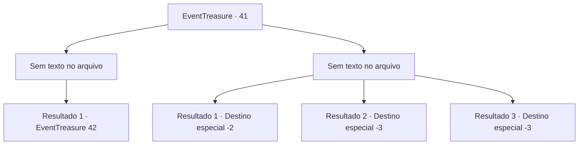

# Eventos de tesouro · 41

[Índice da tabela](index.md) · [Índice geral](../index.md)

ID: `pt:EventTreasure:41` · Fonte: `EventTreasure4` · Versão: 1.2.47.

Mapeamento estático dos arquivos; a disponibilidade e a execução dependem do estado da run.

## Texto do evento

*Sem texto no arquivo.*

## Dados de entrada

```json
{
  "id": 41,
  "grade": 1,
  "place": "",
  "required": ""
}
```

## Mapa das escolhas



## Escolhas e resultados

### Escolha 1

*Sem texto no arquivo; o papel dessa opção depende da interface do jogo.*

Requisitos e outros campos da escolha:

```json
{
  "required": ""
}
```

#### Resultado 1.1

Você derrota o diabinho e pega o minério Mythril.  O diabinho grita ao atingir o chão.  <color=red><link = shake>

 "KRYEAAAAAAAARGH!"

</link></color>  O som do grito dele abala toda a mina.  O calor irradia por dentro das paredes.  Antes que você possa correr, uma criatura gigante emerge do solo.  Ela tem chifres gigantes e segura uma espada em uma mão e um chicote flamejante na outra.  É o Balor.  |drawing_balor|

Continuação registrada: [Evento 42](0042.md) na mesma tabela.

```json
{
  "required": "",
  "chance": "1",
  "nextEvent": 42,
  "type": 2,
  "reward": "6_0_69|3_129_1",
  "place": 6
}
```

### Escolha 2

*Sem texto no arquivo; o papel dessa opção depende da interface do jogo.*

Requisitos e outros campos da escolha:

```json
{
  "required": ""
}
```

#### Resultado 2.1

O diabinho bate em você e toma seu Mythril antes de voar.

Continuação registrada: [Destino especial `-2`](../destinos-especiais.md).

```json
{
  "required": "1_0_2|1_1_2",
  "chance": "1",
  "nextEvent": -2,
  "type": 2,
  "reward": "0_0_-1|0_1_-1|5_58_9|0_2_1"
}
```

#### Resultado 2.2

O diabinho bate em você e o arrasta para o inferno.

Continuação registrada: [Destino especial `-3`](../destinos-especiais.md).

```json
{
  "required": "2_0_2",
  "chance": "1",
  "nextEvent": -3,
  "type": 2,
  "reward": "0_0_-1|0_1_-1"
}
```

#### Resultado 2.3

O diabinho bate em você e o arrasta para o inferno.

Continuação registrada: [Destino especial `-3`](../destinos-especiais.md).

```json
{
  "required": "2_1_2",
  "chance": "1",
  "nextEvent": -3,
  "type": 2,
  "reward": "0_0_-1|0_1_-1"
}
```

## Referências que chegam a este evento

- [Evento 38 · escolha 2 · resultado 1](0038.md#escolha-2)
- [Evento 40 · escolha 1 · resultado 1](0040.md#escolha-1)
