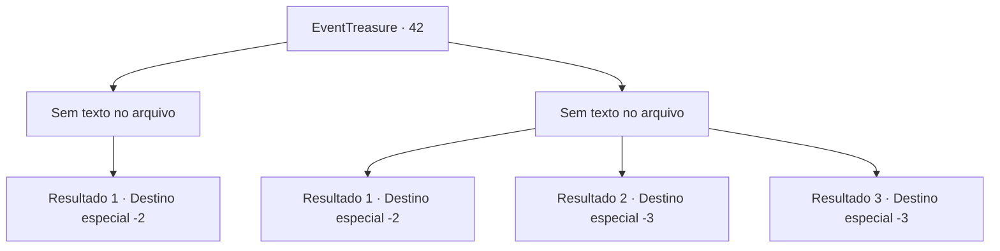

# Eventos de tesouro · 42

[Índice da tabela](index.md) · [Índice geral](../index.md)

ID: `pt:EventTreasure:42` · Fonte: `EventTreasure4` · Versão: 1.2.47.

Mapeamento estático dos arquivos; a disponibilidade e a execução dependem do estado da run.

## Texto do evento

*Sem texto no arquivo.*

## Dados de entrada

```json
{
  "id": 42,
  "grade": 1,
  "place": "",
  "required": ""
}
```

## Mapa das escolhas



## Escolhas e resultados

### Escolha 1

*Sem texto no arquivo; o papel dessa opção depende da interface do jogo.*

Requisitos e outros campos da escolha:

```json
{
  "required": ""
}
```

#### Resultado 1.1

<link=shake><color=red>

 "GRAAAAAAH !!!"

</color></link> Os gritos do Balor retumbam no ar. O ar ao seu redor se distorce enquanto ele desaparece com uma explosão massiva. Você pega fragmentos da lâmina dele no chão. A mina começa a tremer com a explosão e você corre para fora.

Continuação registrada: [Destino especial `-2`](../destinos-especiais.md).

```json
{
  "required": "",
  "chance": "1",
  "nextEvent": -2,
  "type": 2,
  "reward": "5_59_1|3_136_1"
}
```

### Escolha 2

*Sem texto no arquivo; o papel dessa opção depende da interface do jogo.*

Requisitos e outros campos da escolha:

```json
{
  "required": ""
}
```

#### Resultado 2.1

Você luta bravamente, mas bravura não é o suficiente. No final, você não tem escolha a não ser fugir.

Continuação registrada: [Destino especial `-2`](../destinos-especiais.md).

```json
{
  "required": "1_0_2|1_1_2",
  "chance": "1",
  "nextEvent": -2,
  "type": 2,
  "reward": "0_0_-1|0_1_-1|5_58_9|0_2_1"
}
```

#### Resultado 2.2

Você luta bravamente contra o demônio gigante, mas bravura não é suficiente. O chicote flamejante dele te enrola e te queima até os ossos.

Continuação registrada: [Destino especial `-3`](../destinos-especiais.md).

```json
{
  "required": "2_0_2",
  "chance": "1",
  "nextEvent": -3,
  "type": 2,
  "reward": "0_0_-1|0_1_-1"
}
```

#### Resultado 2.3

Você luta bravamente contra o demônio gigante, mas bravura não é suficiente.  O chicote flamejante dele te enrola e te queima até os ossos.

Continuação registrada: [Destino especial `-3`](../destinos-especiais.md).

```json
{
  "required": "2_1_2",
  "chance": "1",
  "nextEvent": -3,
  "type": 2,
  "reward": "0_0_-1|0_1_-1"
}
```

## Referências que chegam a este evento

- [Evento 38 · escolha 3 · resultado 1](0038.md#escolha-3)
- [Evento 39 · escolha 1 · resultado 1](0039.md#escolha-1)
- [Evento 41 · escolha 1 · resultado 1](0041.md#escolha-1)
