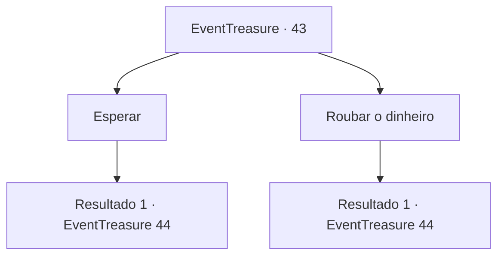

# Eventos de tesouro · 43

[Índice da tabela](index.md) · [Índice geral](../index.md)

ID: `pt:EventTreasure:43` · Fonte: `EventTreasure4` · Versão: 1.2.47.

Mapeamento estático dos arquivos; a disponibilidade e a execução dependem do estado da run.

## Texto do evento

Você visita um ferreiro numa cidade grande para fazer uso do fragmento da Lâmina Vorpal do Balor. O ferreiro inspeciona o fragmento e franze a testa. 

 "Isso é... por Deus... Espere aqui. Eu vou trazer o especialista."

 Ele tira o avental e sai.

## Dados de entrada

```json
{
  "id": 43,
  "grade": 3,
  "place": "",
  "required": "8_136_1|5_95_0"
}
```

## Mapa das escolhas



## Escolhas e resultados

### Escolha 1

Esperar

Requisitos e outros campos da escolha:

```json
{
  "required": ""
}
```

#### Resultado 1.1

Você se senta perto da fundição e espera. Logo, o ferreiro retorna com vários padres e cavaleiros. Um dos padres inspeciona o fragmento. 

 "Deus nos ajude ... Essa coisa está irradiando energia demoníaca ... Por favor, venha conosco. Isso precisa ser limpo."


Continuação registrada: [Evento 44](0044.md) na mesma tabela.

```json
{
  "required": "",
  "chance": "1",
  "nextEvent": 44,
  "type": 2,
  "reward": ""
}
```

### Escolha 2

Roubar o dinheiro

Requisitos e outros campos da escolha:

```json
{
  "required": "2_3_0"
}
```

#### Resultado 2.1

Você vasculha o local e consegue roubar algumas moedas.  Logo, o ferreiro retorna com vários padres e cavaleiros.  Um dos padres inspeciona o fragmento.  

 "Deus nos ajude ... Essa coisa está irradiando energia demoníaca ...  Por favor, venha conosco. Isso precisa ser limpo."


Continuação registrada: [Evento 44](0044.md) na mesma tabela.

```json
{
  "required": "",
  "chance": "1",
  "nextEvent": 44,
  "type": 2,
  "reward": "0_4_20|0_2_1"
}
```

## Referências que chegam a este evento

Nenhum `nextEvent` positivo da mesma tabela aponta para este nó. Isso não prova que seja inacessível: sorteio e estado de história podem selecioná-lo.

