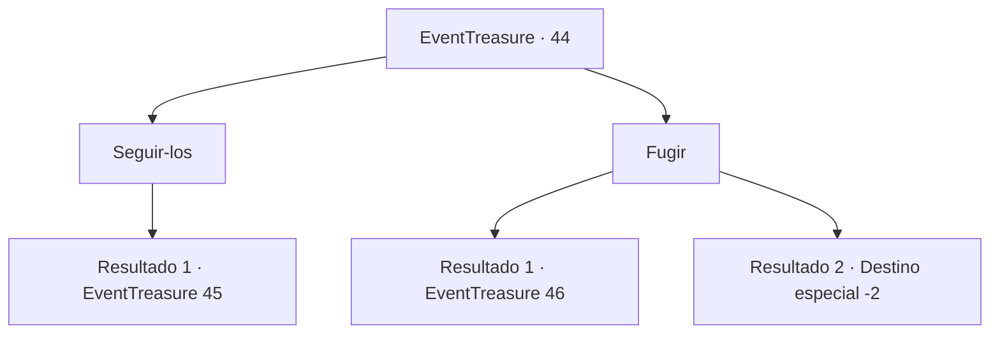

# Eventos de tesouro · 44

[Índice da tabela](index.md) · [Índice geral](../index.md)

ID: `pt:EventTreasure:44` · Fonte: `EventTreasure4` · Versão: 1.2.47.

Mapeamento estático dos arquivos; a disponibilidade e a execução dependem do estado da run.

## Texto do evento

*Sem texto no arquivo.*

## Dados de entrada

```json
{
  "id": 44,
  "grade": 1,
  "place": "",
  "required": ""
}
```

## Mapa das escolhas



## Escolhas e resultados

### Escolha 1

Seguir-los

Requisitos e outros campos da escolha:

```json
{
  "required": ""
}
```

#### Resultado 1.1

|drawing_church|  Você os segue até a igreja.  É uma estrutura majestosa com pilares gigantes e uma torre alta.  Quando você chega à bacia de prata da capela, o padre estende a mão.  Ele está usando uma luva branca.  

 "Por favor, entregue a lâmina."

  Cavaleiros se aproximam de você enquanto ele fala.  Você sente que ele não está perguntando.

Continuação registrada: [Evento 45](0045.md) na mesma tabela.

```json
{
  "required": "",
  "chance": "1",
  "nextEvent": 45,
  "type": 2,
  "reward": ""
}
```

### Escolha 2

Fugir

Requisitos e outros campos da escolha:

```json
{
  "required": ""
}
```

#### Resultado 2.1

Você acha a situação ameaçadora e tenta fugir. Mas a oficina do ferreiro é muito pequena e cheia de gente. Os cavaleiros o pegam e o arrastam para uma igreja. |drawing_church| É uma estrutura majestosa com pilares gigantes e uma torre alta. Quando você chega à bacia de prata da capela, o padre estende a mão. Ele está usando uma luva branca. 

 "Por favor, entregue a lâmina."

 Eles tiram o fragmento da Lâmina Vorpal de você. Em seguida, eles mergulham em água benta. Ela começa a ferver enquanto derrete a peça em fumaça preta e luz branca. 

 "Obrigado por sua cooperação."

 O padre se curva levemente e lhe entrega uma pequena bolsa com ouro.

Continuação registrada: [Evento 46](0046.md) na mesma tabela.

```json
{
  "required": "",
  "chance": "20",
  "nextEvent": 46,
  "type": 1,
  "reward": "4_136_1|0_4_50|0_2_2"
}
```

#### Resultado 2.2

Você não sabe do que se trata tudo isso, mas empurra todos os cavaleiros e sacerdotes de lado,  conseguindo se libertar e fugir. Você terá que encontrar outra maneira de transformar esta peça em uma lâmina.

Continuação registrada: [Destino especial `-2`](../destinos-especiais.md).

```json
{
  "required": "",
  "chance": "1|0_6_1",
  "nextEvent": -2,
  "type": 0,
  "reward": "5_95_9"
}
```

## Referências que chegam a este evento

- [Evento 43 · escolha 1 · resultado 1](0043.md#escolha-1)
- [Evento 43 · escolha 2 · resultado 1](0043.md#escolha-2)
