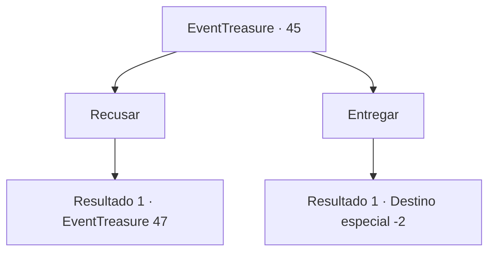

# Eventos de tesouro · 45

[Índice da tabela](index.md) · [Índice geral](../index.md)

ID: `pt:EventTreasure:45` · Fonte: `EventTreasure4` · Versão: 1.2.47.

Mapeamento estático dos arquivos; a disponibilidade e a execução dependem do estado da run.

## Texto do evento

*Sem texto no arquivo.*

## Dados de entrada

```json
{
  "id": 45,
  "grade": 1,
  "place": "",
  "required": ""
}
```

## Mapa das escolhas



## Escolhas e resultados

### Escolha 1

Recusar

Requisitos e outros campos da escolha:

```json
{
  "required": ""
}
```

#### Resultado 1.1

Você se recusa a entregar o fragmento ao padre.  Todos os cavaleiros ao seu redor desembainham suas espadas.  

 "Um demônio já assumiu este aqui. Faça o seu trabalho."


Continuação registrada: [Evento 47](0047.md) na mesma tabela.

```json
{
  "required": "",
  "chance": "1",
  "nextEvent": 47,
  "type": 2,
  "reward": "6_0_50",
  "place": 4
}
```

### Escolha 2

Entregar

Requisitos e outros campos da escolha:

```json
{
  "required": ""
}
```

#### Resultado 2.1

Você entrega o fragmento.  O padre o mergulha em água benta.  Ela começa a ferver enquanto derrete a peça em fumaça preta e luz branca.  

 "Obrigado por sua cooperação. Deus o abençoe."

  O padre se curva levemente e lhe entrega uma lança robusta.  Você sai da igreja com sua nova arma.

Continuação registrada: [Destino especial `-2`](../destinos-especiais.md).

```json
{
  "required": "",
  "chance": "1",
  "nextEvent": -2,
  "type": 2,
  "reward": "3_123_1|0_2_2|4_136_1|5_95_1"
}
```

## Referências que chegam a este evento

- [Evento 44 · escolha 1 · resultado 1](0044.md#escolha-1)
