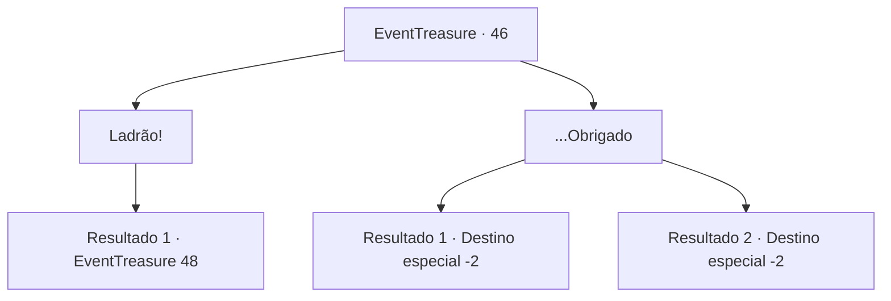

# Eventos de tesouro · 46

[Índice da tabela](index.md) · [Índice geral](../index.md)

ID: `pt:EventTreasure:46` · Fonte: `EventTreasure4` · Versão: 1.2.47.

Mapeamento estático dos arquivos; a disponibilidade e a execução dependem do estado da run.

## Texto do evento

*Sem texto no arquivo.*

## Dados de entrada

```json
{
  "id": 46,
  "grade": 1,
  "place": "",
  "required": ""
}
```

## Mapa das escolhas



## Escolhas e resultados

### Escolha 1

Ladrão!

Requisitos e outros campos da escolha:

```json
{
  "required": ""
}
```

#### Resultado 1.1

Você começa a amaldiçoar os cavaleiros e templários abertamente.  O padre geme de dor e diz a seus cavaleiros.  

 "Um demônio já assumiu este aqui. Façam seu trabalho."

  Todos os cavaleiros ao seu redor desembainham suas espadas.

Continuação registrada: [Evento 48](0048.md) na mesma tabela.

```json
{
  "required": "",
  "chance": "1",
  "nextEvent": 48,
  "type": 2,
  "reward": "6_0_50",
  "place": 4
}
```

### Escolha 2

...Obrigado

Requisitos e outros campos da escolha:

```json
{
  "required": ""
}
```

#### Resultado 2.1

Você olha para a água benta fervendo por um tempo antes de agradecer ao padre.  

 "Não, Irmão. Que Deus o abençoe e o proteja de todo o mal futuro."

  O padre se curva levemente e lhe entrega uma lança robusta.  Você sai da igreja com sua nova arma.

Continuação registrada: [Destino especial `-2`](../destinos-especiais.md).

```json
{
  "required": "11_0_0",
  "chance": "1",
  "nextEvent": -2,
  "type": 2,
  "reward": "3_123_1|0_2_2|5_95_1"
}
```

#### Resultado 2.2

Você olha para a água benta fervendo por um tempo antes de agradecer ao padre.  

 "Não, irmã. Que Deus a abençoe e a proteja de todo o mal futuro."

  O padre se curva levemente e lhe entrega uma lança robusta.  Você sai da igreja com sua nova arma.

Continuação registrada: [Destino especial `-2`](../destinos-especiais.md).

```json
{
  "required": "11_0_1",
  "chance": "1",
  "nextEvent": -2,
  "type": 2,
  "reward": "3_123_1|0_2_2|5_95_1"
}
```

## Referências que chegam a este evento

- [Evento 44 · escolha 2 · resultado 1](0044.md#escolha-2)
