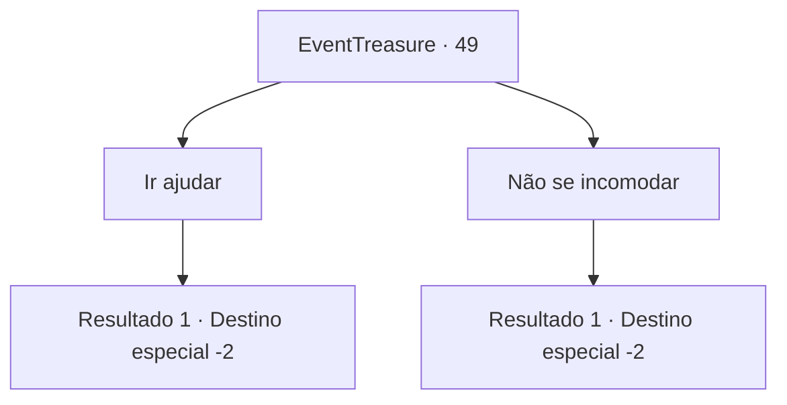

# Eventos de tesouro · 49

[Índice da tabela](index.md) · [Índice geral](../index.md)

ID: `pt:EventTreasure:49` · Fonte: `EventTreasure4` · Versão: 1.2.47.

Mapeamento estático dos arquivos; a disponibilidade e a execução dependem do estado da run.

## Texto do evento

Você vê um anão pendurando um anúncio no quadro de avisos da cidade. Então, ele rapidamente vai embora com vários pergaminhos debaixo do braço. Você se aproxima do quadro para ver o que ele pendurou.
 'Nós somos anões de Atard Tidet. É uma cidade mineradora para mineiros e ferreiros. Um dia, os portões do inferno se abriram em uma das minas de Mythril. Um poderoso demônio saiu de lá. Nós não tivemos escolha a não ser fugir. Por favor nos ajude a mandá-lo de volta para o inferno.'

## Dados de entrada

```json
{
  "id": 49,
  "grade": 1,
  "place": "",
  "required": "5_94_0"
}
```

## Mapa das escolhas



## Escolhas e resultados

### Escolha 1

Ir ajudar

Requisitos e outros campos da escolha:

```json
{
  "required": ""
}
```

#### Resultado 1.1

Você pega o pergaminho e segue para Atard Tidet.

Continuação registrada: [Destino especial `-2`](../destinos-especiais.md).

```json
{
  "required": "",
  "chance": "1",
  "nextEvent": -2,
  "type": 2,
  "reward": "5_94_1"
}
```

### Escolha 2

Não se incomodar

Requisitos e outros campos da escolha:

```json
{
  "required": ""
}
```

#### Resultado 2.1

Você ignora o pôster e segue em frente.

Continuação registrada: [Destino especial `-2`](../destinos-especiais.md).

```json
{
  "required": "",
  "chance": "1",
  "nextEvent": -2,
  "type": 2,
  "reward": ""
}
```

## Referências que chegam a este evento

Nenhum `nextEvent` positivo da mesma tabela aponta para este nó. Isso não prova que seja inacessível: sorteio e estado de história podem selecioná-lo.

