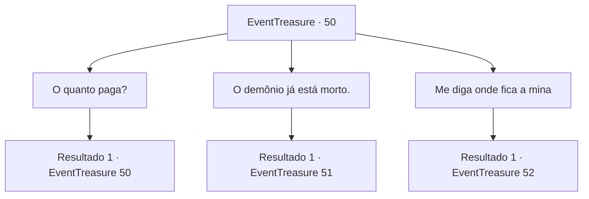

# Eventos de tesouro · 50

[Índice da tabela](index.md) · [Índice geral](../index.md)

ID: `pt:EventTreasure:50` · Fonte: `EventTreasure4` · Versão: 1.2.47.

Mapeamento estático dos arquivos; a disponibilidade e a execução dependem do estado da run.

## Texto do evento

Você segue as instruções no pergaminho e viaja por um caminho na montanha. Logo você chega numa mina com uma placa escrito Atard Tidet. Você anda pelo túnel e chega numa imensa abertura cheia de anões. |drawing_caveCity| Um deles se aproxima e pergunta. 

 "Você leu um dos panfletos, certo? Bem-vindo. Eu sou Brickbee de Atard Tidet. Me pergunte o que quiser saber sobre o trabalho."


## Dados de entrada

```json
{
  "id": 50,
  "grade": 2,
  "place": "",
  "required": "5_94_1"
}
```

## Mapa das escolhas



## Escolhas e resultados

### Escolha 1

O quanto paga?

Requisitos e outros campos da escolha:

```json
{
  "required": "5_94_1"
}
```

#### Resultado 1.1

Você pergunta quanto eles vão pagar em troca.  Brickbee passa a mão pela barba ruiva e responde alegremente.  

 "Mate o demônio e traga-nos a lâmina dele!  Vamos recompensá-lo com algo inestimável."


Continuação registrada: [Evento 50](0050.md) na mesma tabela.

```json
{
  "required": "",
  "chance": "1",
  "nextEvent": 50,
  "type": 2,
  "reward": "5_94_2"
}
```

### Escolha 2

O demônio já está morto.

Requisitos e outros campos da escolha:

```json
{
  "required": "5_59_1"
}
```

#### Resultado 2.1

Você diz a eles que já cuidou de Balor.  

 "Mate o demônio e traga a lâmi .. Você fez o quê? Você já o matou ?!"

  As sobrancelhas de Brickbee se contraem de surpresa.  

 "Eu ... vejo ... Então me mostre. Vamos para a mina Mythril."

  Ele pega sua mão e mostra o caminho.  

  Logo, vocês dois chegam na entrada.  Você anda pelo túnel familiar.  Só que desta vez, você percebe que o calor se foi.  Você passa pelo diabinho morto e pelo cão do inferno.  O anão parece intimidado por todos os cadáveres. O espírito alegre dele não está em lugar nenhum.  

  Você e Brickbee chegam ao final do túnel.  Ele está pasmo.  

 "Você ... você estava certo ...!"

  Ele parece surpreso, mas também preocupado.  

 "Mas não há como saber se você fez isso. Eu preciso de provas."


Continuação registrada: [Evento 51](0051.md) na mesma tabela.

```json
{
  "required": "",
  "chance": "1",
  "nextEvent": 51,
  "type": 2,
  "reward": ""
}
```

### Escolha 3

Me diga onde fica a mina

Requisitos e outros campos da escolha:

```json
{
  "required": "18_59_1"
}
```

#### Resultado 3.1

Você pergunta a localização da mina. O anão pega sua mão e mostra o caminho. |drawing_mine| Logo, vocês dois chegam na entrada. As paredes irradiam um calor intenso. Você segue o anão ao fundo do túnel. 

 Algum tempo depois, você percebe que uma figura está vindo em sua direção segurando uma tocha. A julgar pelo som que faz e pela forma da silhueta, você pode dizer que não é humano.

Continuação registrada: [Evento 52](0052.md) na mesma tabela.

```json
{
  "required": "",
  "chance": "1",
  "nextEvent": 52,
  "type": 2,
  "reward": ""
}
```

## Referências que chegam a este evento

- [Evento 50 · escolha 1 · resultado 1](0050.md#escolha-1)
