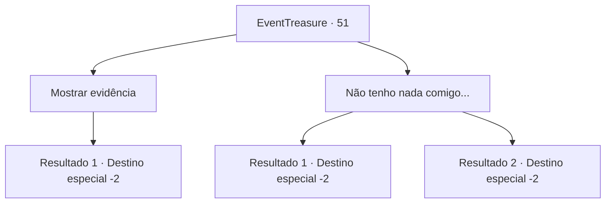

# Eventos de tesouro · 51

[Índice da tabela](index.md) · [Índice geral](../index.md)

ID: `pt:EventTreasure:51` · Fonte: `EventTreasure4` · Versão: 1.2.47.

Mapeamento estático dos arquivos; a disponibilidade e a execução dependem do estado da run.

## Texto do evento

*Sem texto no arquivo.*

## Dados de entrada

```json
{
  "id": 51,
  "grade": 1,
  "place": "",
  "required": ""
}
```

## Mapa das escolhas



## Escolhas e resultados

### Escolha 1

Mostrar evidência

Requisitos e outros campos da escolha:

```json
{
  "required": "8_136_1"
}
```

#### Resultado 1.1

Você mostra a ele seu fragmento da Lâmina Vorpal.  Ele inspeciona e os olhos se arregalam.  

 "É, é verdade ... Você realmente o matou!"

  O anão dança e abraça você com força.  Em seguida, ele olha para você e aperta ambas as mãos para cima e para baixo.  

 "Obrigado ... Obrigado. Você salvou nossa cidade!  Dê-nos um mês, e nós forjaremos nossa melhor arma com esta peça."

  Ele pega o que resta da lâmina e volta para a cidade.

Continuação registrada: [Destino especial `-2`](../destinos-especiais.md).

```json
{
  "required": "",
  "chance": "1",
  "nextEvent": -2,
  "type": 2,
  "reward": "4_136_1|5_94_3"
}
```

### Escolha 2

Não tenho nada comigo...

Requisitos e outros campos da escolha:

```json
{
  "required": "10_136_1"
}
```

#### Resultado 2.1

Você diz a ele que não tem nenhuma evidência com você.  Ele suspira e responde.  

 "Hmm ... Não podemos dizer com certeza que você fez isso, mas pelo menos nos avisou que estamos seguros ... Portanto, devemos a você algum tipo de recompensa."

  Ele lhe entrega uma bolsa pesada com ouro  e volta para a cidade.

Continuação registrada: [Destino especial `-2`](../destinos-especiais.md).

```json
{
  "required": "18_95_1",
  "chance": "1",
  "nextEvent": -2,
  "type": 2,
  "reward": "0_2_1|0_4_100|5_94_4"
}
```

#### Resultado 2.2

Você se lembra como a lâmina Vorpal derreteu em água benta,  e diz a ele que você não tem nenhuma evidência com você.  

 "Hmm ... Não podemos dizer com certeza que você fez isso, mas pelo menos nos avisou que estamos seguros ... Portanto, devemos a você algum tipo de recompensa."

  Ele lhe entrega uma bolsa pesada com ouro  e volta para a cidade.

Continuação registrada: [Destino especial `-2`](../destinos-especiais.md).

```json
{
  "required": "5_95_1",
  "chance": "1",
  "nextEvent": -2,
  "type": 2,
  "reward": "0_2_1|0_4_100|5_94_4"
}
```

## Referências que chegam a este evento

- [Evento 50 · escolha 2 · resultado 1](0050.md#escolha-2)
