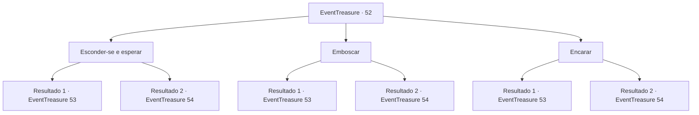

# Eventos de tesouro · 52

[Índice da tabela](index.md) · [Índice geral](../index.md)

ID: `pt:EventTreasure:52` · Fonte: `EventTreasure4` · Versão: 1.2.47.

Mapeamento estático dos arquivos; a disponibilidade e a execução dependem do estado da run.

## Texto do evento

*Sem texto no arquivo.*

## Dados de entrada

```json
{
  "id": 52,
  "grade": 1,
  "place": "",
  "required": ""
}
```

## Mapa das escolhas



## Escolhas e resultados

### Escolha 1

Esconder-se e esperar

Requisitos e outros campos da escolha:

```json
{
  "required": ""
}
```

#### Resultado 1.1

Você se esconde no canto.  A figura com a tocha revelou ser um cão infernal cuspidor de fogo.  Passa perto de você, quando se aproxima.  Em seguida, ele fareja e localiza você.  <link=shake>

 "Grrrr ...."

</link>  Você se prepara para lutar contra a besta do inferno.

Continuação registrada: [Evento 53](0053.md) na mesma tabela.

```json
{
  "required": "",
  "chance": "9",
  "nextEvent": 53,
  "type": 1,
  "reward": "6_0_67",
  "place": 6
}
```

#### Resultado 1.2

Você empurra um carrinho de mineração e se esconde em um canto. A figura com a tocha revelou ser um cão infernal cuspidor de fogo. Ele persegue o carrinho em movimento pelo túnel e desaparece. Você segue na direção oposta de onde o carrinho está. 

 Bem no fundo da mina, você encontra Mythril. Ele está preso em uma camada sólida de rocha. Você está prestes a quebra-lá com sua picareta quando ouve uma voz. 

 "Ei, quem deixou você minerar aqui?"

 Você se vira e encontra um corvo falando com você.

Continuação registrada: [Evento 54](0054.md) na mesma tabela.

```json
{
  "required": "",
  "chance": "1|0_7_1",
  "nextEvent": 54,
  "type": 0,
  "reward": ""
}
```

### Escolha 2

Emboscar

Requisitos e outros campos da escolha:

```json
{
  "required": ""
}
```

#### Resultado 2.1

Você se esconde no canto.  A figura com a tocha revelou ser um cão infernal cuspidor de fogo.  Quando ele passa bem perto de você, você o ataca.  Mas a besta se esquiva como se estivesse esperando por você.  <link=shake>

 "RAAAAAR!"

</link>  Chamas saem das mandíbulas da besta quando ela começa a correr em sua direção.

Continuação registrada: [Evento 53](0053.md) na mesma tabela.

```json
{
  "required": "",
  "chance": "11",
  "nextEvent": 53,
  "type": 1,
  "reward": "6_3_67",
  "place": 6
}
```

#### Resultado 2.2

Você se esconde no canto. A figura com a tocha revelou-se um cão infernal cuspidor de fogo. Quando ele passa perto de você, você avança e ataca. A fera cai sem fazer barulho. Você deixa a carcaça para trás e caminha mais para dentro. 

 Bem no fundo da mina, Brickbee localiza Mythril. Ele está preso em uma camada sólida de rocha. Ele está inspecionando o metal quando você ouve uma voz. 

 "Ei, quem deixou você minerar aqui?"

 Você se vira e encontra um corvo falando com você.

Continuação registrada: [Evento 54](0054.md) na mesma tabela.

```json
{
  "required": "",
  "chance": "1|0_6_1",
  "nextEvent": 54,
  "type": 0,
  "reward": "0_2_2"
}
```

### Escolha 3

Encarar

Requisitos e outros campos da escolha:

```json
{
  "required": ""
}
```

#### Resultado 3.1

Você orgulhosamente dá um passo à frente.  A figura com a tocha revelou ser um cão infernal cuspidor de fogo.  Ele te vê e mostra os dentes.  <link=shake>

 "Grrrr ...."

</link>  Você se prepara para lutar contra a besta do inferno.

Continuação registrada: [Evento 53](0053.md) na mesma tabela.

```json
{
  "required": "",
  "chance": "14",
  "nextEvent": 53,
  "type": 1,
  "reward": "6_0_67",
  "place": 6
}
```

#### Resultado 3.2

Você orgulhosamente dá um passo à frente. A figura com a tocha revelou ser um cão infernal cuspidor de fogo. Ele persegue o carrinho em movimento pelo túnel e desaparece. Ele o vê e sai correndo com o rabo enfiado entre as pernas. Você caminha mais para dentro com facilidade. 

 Bem no fundo da mina, Brickbee localiza Mythril. Ele está preso em uma camada sólida de rocha. Ele está inspecionando o metal quando você ouve uma voz. 

 "Ei, quem deixou você minerar aqui?"

 Você se vira e encontra um corvo falando com você.

Continuação registrada: [Evento 54](0054.md) na mesma tabela.

```json
{
  "required": "",
  "chance": "1|0_12_1",
  "nextEvent": 54,
  "type": 0,
  "reward": "0_2_2"
}
```

## Referências que chegam a este evento

- [Evento 50 · escolha 3 · resultado 1](0050.md#escolha-3)
