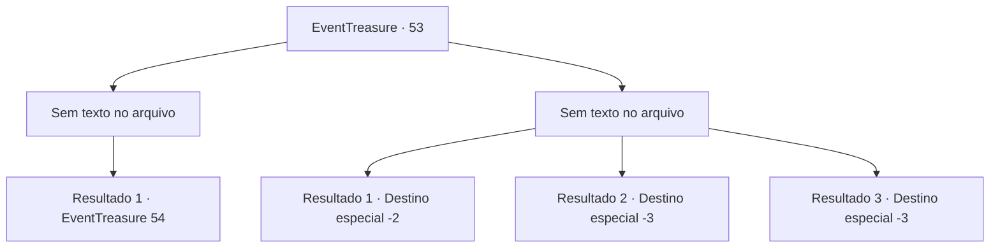

# Eventos de tesouro · 53

[Índice da tabela](index.md) · [Índice geral](../index.md)

ID: `pt:EventTreasure:53` · Fonte: `EventTreasure4` · Versão: 1.2.47.

Mapeamento estático dos arquivos; a disponibilidade e a execução dependem do estado da run.

## Texto do evento

*Sem texto no arquivo.*

## Dados de entrada

```json
{
  "id": 53,
  "grade": 1,
  "place": "",
  "required": ""
}
```

## Mapa das escolhas



## Escolhas e resultados

### Escolha 1

*Sem texto no arquivo; o papel dessa opção depende da interface do jogo.*

Requisitos e outros campos da escolha:

```json
{
  "required": ""
}
```

#### Resultado 1.1

O cão infernal cai. Brickbee emerge de esconderijo, enxugando o suor frio da testa. 

 "Ufa ... Você é um grande lutador."

 Você deixa a carcaça do cão infernal para trás e caminha mais para dentro. 

 Bem no fundo da mina, Brickbee localiza mythril. Ele está preso em uma camada sólida. Ele está inspecionando o metal quando você ouve uma voz. 

 "Ei, quem deixou você minerar aqui?"

 Você se vira e encontra um corvo falando com você.

Continuação registrada: [Evento 54](0054.md) na mesma tabela.

```json
{
  "required": "",
  "chance": "1",
  "nextEvent": 54,
  "type": 2,
  "reward": ""
}
```

### Escolha 2

*Sem texto no arquivo; o papel dessa opção depende da interface do jogo.*

Requisitos e outros campos da escolha:

```json
{
  "required": ""
}
```

#### Resultado 2.1

Raspados pelos dentes e queimados pelas chamas do cão, você e Brickbee se viram para escapar.  O cão os perseguem, mas para quando vê o sol.  Vocês dois mal estão vivos.  Brickbee suspira e fala.  

 "Ufa ... Acho que isso era pedir demais de você. Vamos voltar."

  Ele diz sombriamente enquanto começa a caminhar em direção à cidade.

Continuação registrada: [Destino especial `-2`](../destinos-especiais.md).

```json
{
  "required": "1_0_2|1_1_2",
  "chance": "1",
  "nextEvent": -2,
  "type": 2,
  "reward": "0_0_-1|0_1_-1|5_94_4|0_2_1"
}
```

#### Resultado 2.2

O cão infernal transforma você em um bife bem passado.

Continuação registrada: [Destino especial `-3`](../destinos-especiais.md).

```json
{
  "required": "2_0_2",
  "chance": "1",
  "nextEvent": -3,
  "type": 2,
  "reward": "0_0_-1|0_1_-1"
}
```

#### Resultado 2.3

O cão infernal transforma você em um bife bem passado.

Continuação registrada: [Destino especial `-3`](../destinos-especiais.md).

```json
{
  "required": "2_1_2",
  "chance": "1",
  "nextEvent": -3,
  "type": 2,
  "reward": "0_0_-1|0_1_-1"
}
```

## Referências que chegam a este evento

- [Evento 52 · escolha 1 · resultado 1](0052.md#escolha-1)
- [Evento 52 · escolha 2 · resultado 1](0052.md#escolha-2)
- [Evento 52 · escolha 3 · resultado 1](0052.md#escolha-3)
