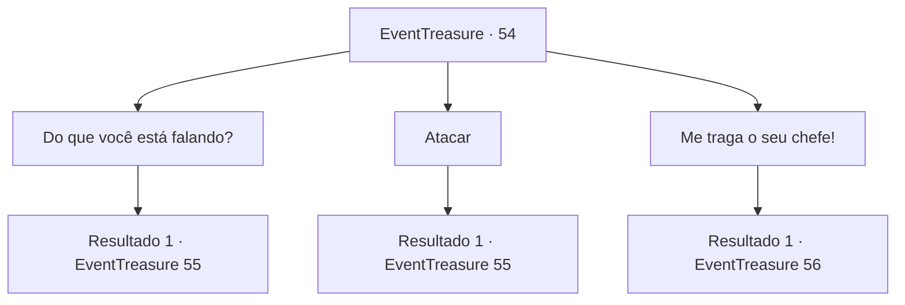

# Eventos de tesouro · 54

[Índice da tabela](index.md) · [Índice geral](../index.md)

ID: `pt:EventTreasure:54` · Fonte: `EventTreasure4` · Versão: 1.2.47.

Mapeamento estático dos arquivos; a disponibilidade e a execução dependem do estado da run.

## Texto do evento

*Sem texto no arquivo.*

## Dados de entrada

```json
{
  "id": 54,
  "grade": 1,
  "place": "",
  "required": ""
}
```

## Mapa das escolhas



## Escolhas e resultados

### Escolha 1

Do que você está falando?

Requisitos e outros campos da escolha:

```json
{
  "required": ""
}
```

#### Resultado 1.1

Você pergunta ao corvo o que isso significa.  Ele começa a explicar.  

 "Esta mina aqui é propriedade do Grande Balor, então o que quero dizer é se mandem daqui."

  Ele coça as penas com o bico e continua.  

 "Mas eu posso reconsiderar se você me der nove décimos desse minério Mythril."

  Brickbee responde batendo no corvo.  Ele cai no chão e muda de forma conforme se levanta.  

 "Então é assim que vai ser ..."

  Acontece que não é um corvo, mas um diabinho disfarçado.  Ele furiosamente aponta uma lança contra vocês.

Continuação registrada: [Evento 55](0055.md) na mesma tabela.

```json
{
  "required": "",
  "chance": "1",
  "nextEvent": 55,
  "type": 2,
  "reward": "6_2_68",
  "place": 6
}
```

### Escolha 2

Atacar

Requisitos e outros campos da escolha:

```json
{
  "required": ""
}
```

#### Resultado 2.1

Você bate no corvo.  Ele cai no chão e muda de forma conforme se levanta.  

 "Então é assim que vai ser ..."

  Acontece que não é um corvo, mas um diabinho disfarçado.  Ele furiosamente aponta uma lança contra vocês.

Continuação registrada: [Evento 55](0055.md) na mesma tabela.

```json
{
  "required": "",
  "chance": "1",
  "nextEvent": 55,
  "type": 2,
  "reward": "6_2_68",
  "place": 6
}
```

### Escolha 3

Me traga o seu chefe!

Requisitos e outros campos da escolha:

```json
{
  "required": ""
}
```

#### Resultado 3.1

Você exige que o corvo traga seu chefe. O pássaro ri e vai embora. <link=wave><color=red>

 "KAW...KAW...KAW..."

</color></link> O som de seu grito chacoalha toda a mina. Calor irradia das profundezas entre as paredes. Antes que você possa correr, uma criatura gigantesca surge do chão. Ele tem chifres enormes e segura uma espada numa mão, e um chicote flamejante na outra. É Balor. Você olha para trás e vê que Brickbee não está lá. |drawing_balor|

Continuação registrada: [Evento 56](0056.md) na mesma tabela.

```json
{
  "required": "",
  "chance": "1",
  "nextEvent": 56,
  "type": 2,
  "reward": "6_0_69",
  "place": 6
}
```

## Referências que chegam a este evento

- [Evento 52 · escolha 1 · resultado 2](0052.md#escolha-1)
- [Evento 52 · escolha 2 · resultado 2](0052.md#escolha-2)
- [Evento 52 · escolha 3 · resultado 2](0052.md#escolha-3)
- [Evento 53 · escolha 1 · resultado 1](0053.md#escolha-1)
