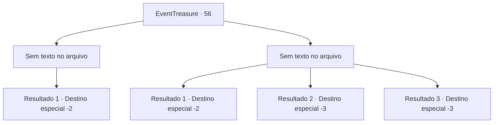

# Eventos de tesouro · 56

[Índice da tabela](index.md) · [Índice geral](../index.md)

ID: `pt:EventTreasure:56` · Fonte: `EventTreasure4` · Versão: 1.2.47.

Mapeamento estático dos arquivos; a disponibilidade e a execução dependem do estado da run.

## Texto do evento

*Sem texto no arquivo.*

## Dados de entrada

```json
{
  "id": 56,
  "grade": 1,
  "place": "",
  "required": ""
}
```

## Mapa das escolhas



## Escolhas e resultados

### Escolha 1

*Sem texto no arquivo; o papel dessa opção depende da interface do jogo.*

Requisitos e outros campos da escolha:

```json
{
  "required": ""
}
```

#### Resultado 1.1

<link=shake><color=red>

 "GRAAAAAAH!!!"

</color></link> Os gritos de Balor estrondam pelo ar. O ar ao redor dele distorce à medida que ele desaparece numa explosão massiva. Brickbee recolhe do chão fragmentos da lâmina de Balor. 

 "Depressa! Esse lugar pode desabar a qualquer momento!"

 Vocês dois correm para fora da mina. Depois de recuperar o fôlego, ele aperta e balança suas mãos pra cima e pra baixo. 

 "Obrigado! Com o demônio morto, nós podemos voltar a minerar Mythril."

 Ele te diz para voltar em um mês, e volta para a cidade 

Continuação registrada: [Destino especial `-2`](../destinos-especiais.md).

```json
{
  "required": "",
  "chance": "1",
  "nextEvent": -2,
  "type": 2,
  "reward": "5_94_3"
}
```

### Escolha 2

*Sem texto no arquivo; o papel dessa opção depende da interface do jogo.*

Requisitos e outros campos da escolha:

```json
{
  "required": ""
}
```

#### Resultado 2.1

O diabinho te derrota e você é forçado a fugir. Brickbee suspira. 

 "Ufa... eu acho que isso foi te pedir muito. Vamos voltar."

 Ele diz com tristeza e começa a andar rumo à cidade.

Continuação registrada: [Destino especial `-2`](../destinos-especiais.md).

```json
{
  "required": "1_0_2|1_1_2",
  "chance": "1",
  "nextEvent": -2,
  "type": 2,
  "reward": "0_0_-1|0_1_-1|5_94_4|0_2_1"
}
```

#### Resultado 2.2

Você luta bravamente contra o gigantesco demônio, mas bravura não é suficiente. O chicote flamejante dele enrola ao teu redor e te queima até os ossos.

Continuação registrada: [Destino especial `-3`](../destinos-especiais.md).

```json
{
  "required": "2_0_2",
  "chance": "1",
  "nextEvent": -3,
  "type": 2,
  "reward": "0_0_-1|0_1_-1"
}
```

#### Resultado 2.3

Você luta bravamente contra o gigantesco demônio, mas bravura não é suficiente. O chicote flamejante dele enrola ao teu redor e te queima até os ossos.

Continuação registrada: [Destino especial `-3`](../destinos-especiais.md).

```json
{
  "required": "2_1_2",
  "chance": "1",
  "nextEvent": -3,
  "type": 2,
  "reward": "0_0_-1|0_1_-1"
}
```

## Referências que chegam a este evento

- [Evento 54 · escolha 3 · resultado 1](0054.md#escolha-3)
- [Evento 55 · escolha 1 · resultado 1](0055.md#escolha-1)
