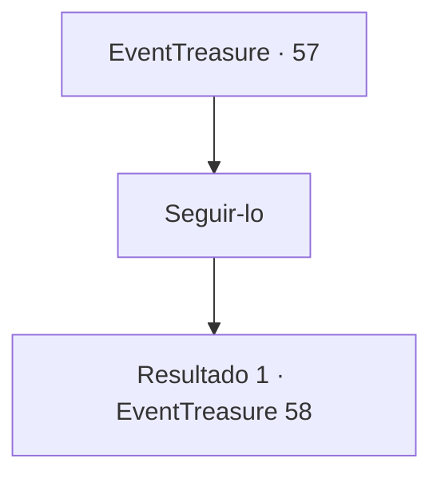

# Eventos de tesouro · 57

[Índice da tabela](index.md) · [Índice geral](../index.md)

ID: `pt:EventTreasure:57` · Fonte: `EventTreasure4` · Versão: 1.2.47.

Mapeamento estático dos arquivos; a disponibilidade e a execução dependem do estado da run.

## Texto do evento

Você se lembra o que o anão Brickbee te disse e aparece em Atard Tidet. A cidade mineradora está próspera. Você esbarra em Brickbee perto da entrada. Ele te recebe calorosamente. 

 "Ah! Bom te ver. Eu estava indo te procurar."

 Ele gesticula para você o seguir e mostra o caminho.

## Dados de entrada

```json
{
  "id": 57,
  "grade": 2,
  "place": "",
  "required": "5_94_3"
}
```

## Mapa das escolhas



## Escolhas e resultados

### Escolha 1

Seguir-lo

Requisitos e outros campos da escolha:

```json
{
  "required": ""
}
```

#### Resultado 1.1

Você segue Brickbee até o salão da cidade. Ele é feito de pedra branca, esculpida com muita precisão. O salão está repleto de anões idosos com barbas brancas, presumidamente os anciões da cidade. Eles sorriem e batem palmas quando você entra. O que tem a barba mais decorada fala. 

 "Bem-vindo. Eu ouvi dizer que você recuperou nossa mina de Mythril. Nós estivemos trabalhando numa arma que fizesse jus ao teu valor. Eu espero que goste."

 Ele te entrega algo embrulhado em um pano branco.

Continuação registrada: [Evento 58](0058.md) na mesma tabela.

```json
{
  "required": "",
  "chance": "1",
  "nextEvent": 58,
  "type": 2,
  "reward": "5_94_9"
}
```

## Referências que chegam a este evento

Nenhum `nextEvent` positivo da mesma tabela aponta para este nó. Isso não prova que seja inacessível: sorteio e estado de história podem selecioná-lo.

