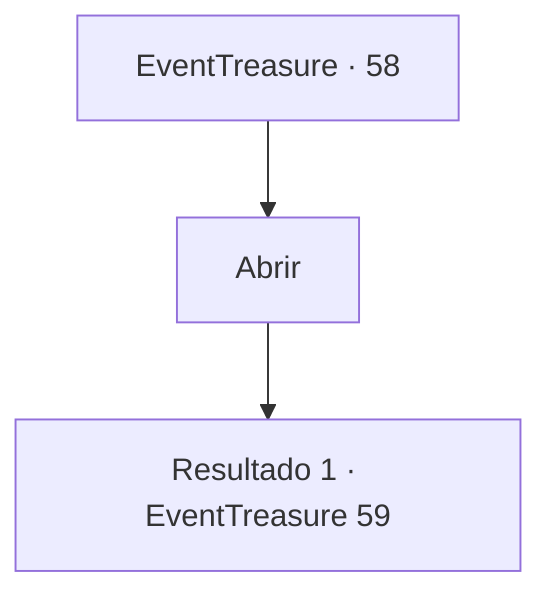

# Eventos de tesouro · 58

[Índice da tabela](index.md) · [Índice geral](../index.md)

ID: `pt:EventTreasure:58` · Fonte: `EventTreasure4` · Versão: 1.2.47.

Mapeamento estático dos arquivos; a disponibilidade e a execução dependem do estado da run.

## Texto do evento

*Sem texto no arquivo.*

## Dados de entrada

```json
{
  "id": 58,
  "grade": 1,
  "place": "",
  "required": ""
}
```

## Mapa das escolhas



## Escolhas e resultados

### Escolha 1

Abrir

Requisitos e outros campos da escolha:

```json
{
  "required": ""
}
```

#### Resultado 1.1

Sob o pano há uma adaga azul luminescente. Os anões sorriem satisfeitos. 

 "Estamos orgulhosos de ter forjado tal lâmina. Por favor, faça bom uso dele. Há mais alguma coisa em que possamos ajudá-lo?"


Continuação registrada: [Evento 59](0059.md) na mesma tabela.

```json
{
  "required": "",
  "chance": "1",
  "nextEvent": 59,
  "type": 2,
  "reward": "3_93_1"
}
```

## Referências que chegam a este evento

- [Evento 57 · escolha 1 · resultado 1](0057.md#escolha-1)
