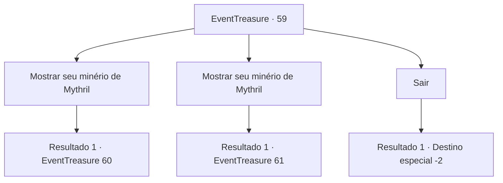

# Eventos de tesouro · 59

[Índice da tabela](index.md) · [Índice geral](../index.md)

ID: `pt:EventTreasure:59` · Fonte: `EventTreasure4` · Versão: 1.2.47.

Mapeamento estático dos arquivos; a disponibilidade e a execução dependem do estado da run.

## Texto do evento

*Sem texto no arquivo.*

## Dados de entrada

```json
{
  "id": 59,
  "grade": 1,
  "place": "",
  "required": ""
}
```

## Mapa das escolhas



## Escolhas e resultados

### Escolha 1

Mostrar seu minério de Mythril

Requisitos e outros campos da escolha:

```json
{
  "required": "8_128_1"
}
```

#### Resultado 1.1

O anão ancião examina o Mythril enquanto afaga a própria barba.  

 "Hmm. Isso não é suficiente para uma arma nova, mas o suficiente para revestir uma uma que já existe. Você tem alguma? Brickbee vai ajudar."


Continuação registrada: [Evento 60](0060.md) na mesma tabela.

```json
{
  "required": "",
  "chance": "1",
  "nextEvent": 60,
  "type": 2,
  "reward": ""
}
```

### Escolha 2

Mostrar seu minério de Mythril

Requisitos e outros campos da escolha:

```json
{
  "required": "8_129_1"
}
```

#### Resultado 2.1

O anão ancião examina o Mythril enquanto afaga a própria barba. 

 "Ah, vai servir. Você tem uma arma em mente? Brickbee vai ajudar com qualquer coisa."


Continuação registrada: [Evento 61](0061.md) na mesma tabela.

```json
{
  "required": "",
  "chance": "1",
  "nextEvent": 61,
  "type": 2,
  "reward": ""
}
```

### Escolha 3

Sair

Requisitos e outros campos da escolha:

```json
{
  "required": ""
}
```

#### Resultado 3.1

Você não tem mais nada a pedir para os anões, então você vai embora da cidade deles. Eles acenam se despedindo enquanto você vai andando.

Continuação registrada: [Destino especial `-2`](../destinos-especiais.md).

```json
{
  "required": "",
  "chance": "1",
  "nextEvent": -2,
  "type": 2,
  "reward": "0_2_2|0_3_1"
}
```

## Referências que chegam a este evento

- [Evento 58 · escolha 1 · resultado 1](0058.md#escolha-1)
