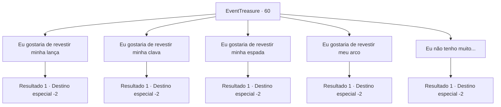

# Eventos de tesouro · 60

[Índice da tabela](index.md) · [Índice geral](../index.md)

ID: `pt:EventTreasure:60` · Fonte: `EventTreasure4` · Versão: 1.2.47.

Mapeamento estático dos arquivos; a disponibilidade e a execução dependem do estado da run.

## Texto do evento

*Sem texto no arquivo.*

## Dados de entrada

```json
{
  "id": 60,
  "grade": 1,
  "place": "",
  "required": ""
}
```

## Mapa das escolhas



## Escolhas e resultados

### Escolha 1

Eu gostaria de revestir minha lança

Requisitos e outros campos da escolha:

```json
{
  "required": "8_58_1"
}
```

#### Resultado 1.1

Brickbee pega sua arma e o fragmento de Mythril. Ele diz que vai levar alguns dias. Então ele se inclina perante os anciãos e sai do salão. Você decide passar um pouco de tempo na cidade. 

 Alguns dias depois, você visita Brickbee. Ele orgulhosamente apresenta sua nova alabarda de Mythril. 

 "Aqui está. Que Muradan abençoe sua alma!"

 Você pega a arma e continua sua jornada.

Continuação registrada: [Destino especial `-2`](../destinos-especiais.md).

```json
{
  "required": "",
  "chance": "1",
  "nextEvent": -2,
  "type": 2,
  "reward": "4_128_1|4_58_1|3_59_1|0_2_2|5_94_5"
}
```

### Escolha 2

Eu gostaria de revestir minha clava

Requisitos e outros campos da escolha:

```json
{
  "required": "8_62_1"
}
```

#### Resultado 2.1

Brickbee pega sua arma e o fragmento de Mithril. Ele diz que levará alguns dias. Em seguida, ele se curva aos anciãos e sai do salão. Você decide passar um tempo na cidade. 

 Alguns dias depois, você visita Brickbee. Ele apresenta com orgulho sua nova maça de Mithril. 

 "Aqui está. Que Muradan abençoe sua alma!"

 Você pega a arma e continua sua jornada.

Continuação registrada: [Destino especial `-2`](../destinos-especiais.md).

```json
{
  "required": "",
  "chance": "1",
  "nextEvent": -2,
  "type": 2,
  "reward": "4_128_1|4_62_1|3_63_1|0_2_2|5_94_5"
}
```

### Escolha 3

Eu gostaria de revestir minha espada

Requisitos e outros campos da escolha:

```json
{
  "required": "8_74_1"
}
```

#### Resultado 3.1

Brickbee pega sua arma e o fragmento de Mithril. Ele diz que vai levar alguns dias. Então ele se inclina diante dos anciãos e sai do salão. Você decide passar um tempo na cidade. 

 Alguns dias depois, você visita Brickbee. Ele apresenta orgulhosamente sua nova espada de armar de Mithril. 

 "Aqui está. Que Muradan abençoe sua alma!"

 Você pega a arma e continua sua jornada.

Continuação registrada: [Destino especial `-2`](../destinos-especiais.md).

```json
{
  "required": "",
  "chance": "1",
  "nextEvent": -2,
  "type": 2,
  "reward": "4_128_1|4_74_1|3_75_1|0_2_2|5_94_5"
}
```

### Escolha 4

Eu gostaria de revestir meu arco

Requisitos e outros campos da escolha:

```json
{
  "required": "8_78_1"
}
```

#### Resultado 4.1

Brickbee pega sua arma e o fragmento de mitril. Ele diz que vai levar alguns dias. Então ele se curva aos anciãos e sai do salão. Você decide passar um tempo na cidade. 

 Alguns dias depois, você visita Brickbee. Ele orgulhosamente apresenta seu novo arco de mitril. 

 "Aqui está. Que Muradan abençoe sua alma!"

 Você pega a arma e continua sua jornada.

Continuação registrada: [Destino especial `-2`](../destinos-especiais.md).

```json
{
  "required": "",
  "chance": "1",
  "nextEvent": -2,
  "type": 2,
  "reward": "4_128_1|4_78_1|3_79_1|0_2_2|5_94_5"
}
```

### Escolha 5

Eu não tenho muito...

Requisitos e outros campos da escolha:

```json
{
  "required": ""
}
```

#### Resultado 5.1

Você confessa que não tem nada com que ele possa trabalhar. Brickbee cruza os braços e pensa por um momento antes de falar. 

 "Bem, nesse caso, vou te dar um dos meus."

 Em seguida ele se curva aos anciões e sai do salão. Você o segue até a casa dele. Ele entra no depósito e volta com um escudo da altura dele. 

 "Eu costumava carregar isto quando era jovem. Mas não o usei muito... porque eu na maior parte do tempo me mantinha fora de perigo. Enfim, Muradan te abençoe!"

 Você pega o escudo e continua sua jornada.

Continuação registrada: [Destino especial `-2`](../destinos-especiais.md).

```json
{
  "required": "",
  "chance": "1",
  "nextEvent": -2,
  "type": 2,
  "reward": "3_118_1|0_2_2|4_128_1|5_94_5"
}
```

## Referências que chegam a este evento

- [Evento 59 · escolha 1 · resultado 1](0059.md#escolha-1)
