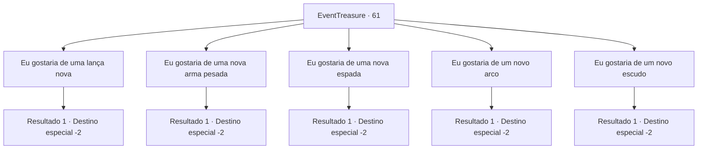

# Eventos de tesouro · 61

[Índice da tabela](index.md) · [Índice geral](../index.md)

ID: `pt:EventTreasure:61` · Fonte: `EventTreasure4` · Versão: 1.2.47.

Mapeamento estático dos arquivos; a disponibilidade e a execução dependem do estado da run.

## Texto do evento

*Sem texto no arquivo.*

## Dados de entrada

```json
{
  "id": 61,
  "grade": 1,
  "place": "",
  "required": ""
}
```

## Mapa das escolhas



## Escolhas e resultados

### Escolha 1

Eu gostaria de uma lança nova

Requisitos e outros campos da escolha:

```json
{
  "required": ""
}
```

#### Resultado 1.1

Brickbee pega sua arma e o fragmento de Mythril. Ele diz que vai demorar alguns dias. Em seguida ele se curva diante dos anciãos e sai do salão. Você decide passar um tempo na cidade. 

 Alguns dias depois, você visita Brickbee. Ele apresenta orgulhosamente sua nova alabarda de Mythril. Aqui está. Que Muradan te abençoe! Você pega a arma e continua sua jornada.

Continuação registrada: [Destino especial `-2`](../destinos-especiais.md).

```json
{
  "required": "",
  "chance": "1",
  "nextEvent": -2,
  "type": 2,
  "reward": "4_129_1|3_59_1|0_2_2|5_94_5"
}
```

### Escolha 2

Eu gostaria de uma nova arma pesada

Requisitos e outros campos da escolha:

```json
{
  "required": ""
}
```

#### Resultado 2.1

Brickbee pega sua arma e o fragmento de Mithril. Ele diz que vai levar alguns dias. Então ele se curva aos anciãos e sai do salão. Você decide passar um tempo na cidade. 

 Alguns dias depois, você visita Brickbee. Ele orgulhosamente apresenta sua nova maça de Mithril. 

 "Aqui está. Muradan te abençoe!"

 Você pega a arma e continua sua jornada.

Continuação registrada: [Destino especial `-2`](../destinos-especiais.md).

```json
{
  "required": "",
  "chance": "1",
  "nextEvent": -2,
  "type": 2,
  "reward": "4_129_1|3_63_1|0_2_2|5_94_5"
}
```

### Escolha 3

Eu gostaria de uma nova espada

Requisitos e outros campos da escolha:

```json
{
  "required": ""
}
```

#### Resultado 3.1

Brickbee pega sua arma e o fragmento de mithril. Ele diz que vai levar alguns dias. Então ele se curva aos anciãos e sai do salão. Você decide passar um tempo na cidade. 

 Alguns dias depois, você visita Brickbee. Ele apresenta orgulhosamente sua nova espada de armar de mithril. 

 "Aqui está. Que Muradan te abençoe!"

 Você pega a arma e continua sua jornada.

Continuação registrada: [Destino especial `-2`](../destinos-especiais.md).

```json
{
  "required": "",
  "chance": "1",
  "nextEvent": -2,
  "type": 2,
  "reward": "4_129_1|3_75_1|0_2_2|5_94_5"
}
```

### Escolha 4

Eu gostaria de um novo arco

Requisitos e outros campos da escolha:

```json
{
  "required": ""
}
```

#### Resultado 4.1

Brickbee pega sua arma e o fragmento de mitril. Ele diz que vai levar alguns dias. Em seguida, ele se curva para os anciãos e sai do salão. Você decide passar um pouco de tempo na cidade. 

 Alguns dias depois, você visita Brickbee. Ele orgulhosamente apresenta seu novo arco de mitril. 

 "Aqui está. Que Muradan te abençoe!"

 Você pega a arma e continua sua jornada.

Continuação registrada: [Destino especial `-2`](../destinos-especiais.md).

```json
{
  "required": "",
  "chance": "1",
  "nextEvent": -2,
  "type": 2,
  "reward": "4_129_1|3_79_1|0_2_2|5_94_5"
}
```

### Escolha 5

Eu gostaria de um novo escudo

Requisitos e outros campos da escolha:

```json
{
  "required": ""
}
```

#### Resultado 5.1

Brickbee pega sua arma e o fragmento de Mythril. Ele diz que vai demorar alguns dias. Em seguida ele se curva diante dos anciãos e sai do salão. Você decide passar um tempo na cidade. 

 Alguns dias depois, você visita Brickbee. Ele apresenta orgulhosamente sua nova alabarda de Mythril. Aqui está. Que Muradan te abençoe! Você pega a arma e continua sua jornada.

Continuação registrada: [Destino especial `-2`](../destinos-especiais.md).

```json
{
  "required": "",
  "chance": "1",
  "nextEvent": -2,
  "type": 2,
  "reward": "4_129_1|3_115_1|0_2_2|5_94_5"
}
```

## Referências que chegam a este evento

- [Evento 59 · escolha 2 · resultado 1](0059.md#escolha-2)
