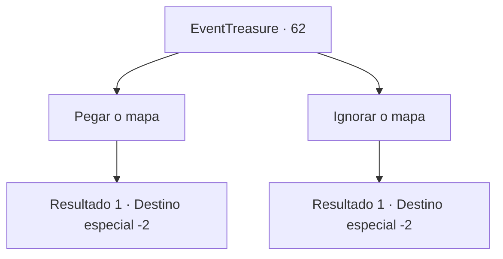

# Eventos de tesouro · 62

[Índice da tabela](index.md) · [Índice geral](../index.md)

ID: `pt:EventTreasure:62` · Fonte: `EventTreasure4` · Versão: 1.2.47.

Mapeamento estático dos arquivos; a disponibilidade e a execução dependem do estado da run.

## Texto do evento

Você para numa cidade do deserto chamada 'Serigia', erguida próxima a um oásis. É um local mercante onde muitos comerciantes que viajam em camelos vêm e vão, e o clima em si não é tão quente, embora não chova muito. Você dá uma olhada no quadro de avisos da cidade, como de costume. Então você acha um mapa muito velho pregado no canto. Sem uma única palavra explicando, o mapa só tinha marcas que levavam a um certo destino. 

## Dados de entrada

```json
{
  "id": 62,
  "grade": 1,
  "place": "",
  "required": "5_107_0"
}
```

## Mapa das escolhas



## Escolhas e resultados

### Escolha 1

Pegar o mapa

Requisitos e outros campos da escolha:

```json
{
  "required": ""
}
```

#### Resultado 1.1

O mapa que só tem o destino desperta seu interesse. Então você segue para o local marcado no mapa antigo, sem saber o que lá te espera.

Continuação registrada: [Destino especial `-2`](../destinos-especiais.md).

```json
{
  "required": "",
  "chance": "1",
  "nextEvent": -2,
  "type": 2,
  "reward": "3_145_1|5_107_1"
}
```

### Escolha 2

Ignorar o mapa

Requisitos e outros campos da escolha:

```json
{
  "required": ""
}
```

#### Resultado 2.1

Você ignora o mapa antigo e olha outros cartazes.

Continuação registrada: [Destino especial `-2`](../destinos-especiais.md).

```json
{
  "required": "",
  "chance": "1",
  "nextEvent": -2,
  "type": 2,
  "reward": "5_107_9"
}
```

## Referências que chegam a este evento

Nenhum `nextEvent` positivo da mesma tabela aponta para este nó. Isso não prova que seja inacessível: sorteio e estado de história podem selecioná-lo.

