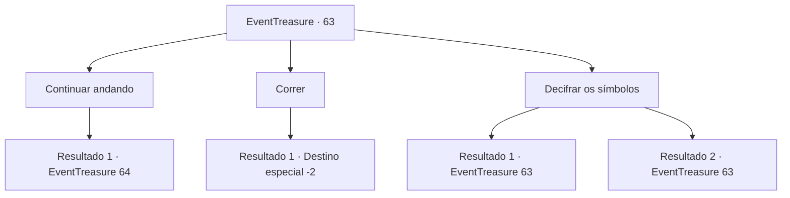

# Eventos de tesouro · 63

[Índice da tabela](index.md) · [Índice geral](../index.md)

ID: `pt:EventTreasure:63` · Fonte: `EventTreasure4` · Versão: 1.2.47.

Mapeamento estático dos arquivos; a disponibilidade e a execução dependem do estado da run.

## Texto do evento

|drawing_gateway| À medida que você caminhava ao destino do mapa antigo, você acha um portão imenso feito de pedra. O portão, que fica entre árvores exuberantes, está marcado com símbolos que aparentemente são letras de uma língua antiga. Você sente uma repentina premonição.

## Dados de entrada

```json
{
  "id": 63,
  "grade": 2,
  "place": "",
  "required": "5_107_1"
}
```

## Mapa das escolhas



## Escolhas e resultados

### Escolha 1

Continuar andando

Requisitos e outros campos da escolha:

```json
{
  "required": ""
}
```

#### Resultado 1.1

Você passa pelo portão, ignorando sua premonição. Então, uma gargula aparece do nada e avança em sua direção.

Continuação registrada: [Evento 64](0064.md) na mesma tabela.

```json
{
  "required": "",
  "chance": "1",
  "nextEvent": 64,
  "type": 2,
  "reward": "6_0_37",
  "place": 1
}
```

### Escolha 2

Correr

Requisitos e outros campos da escolha:

```json
{
  "required": ""
}
```

#### Resultado 2.1

Você vai em direção oposta ao portão, acreditando em sua premonição.

Continuação registrada: [Destino especial `-2`](../destinos-especiais.md).

```json
{
  "required": "",
  "chance": "1",
  "nextEvent": -2,
  "type": 2,
  "reward": "5_107_9"
}
```

### Escolha 3

Decifrar os símbolos

Requisitos e outros campos da escolha:

```json
{
  "required": "5_108_0"
}
```

#### Resultado 3.1

Você encara os símbolos no portão, mas não consegue lembrar de nada relacionado.

Continuação registrada: [Evento 63](0063.md) na mesma tabela.

```json
{
  "required": "",
  "chance": "18",
  "nextEvent": 63,
  "type": 1,
  "reward": "5_108_1"
}
```

#### Resultado 3.2

Você decifra com sucesso o significado dos símbolos após encará-los por um tempo.
 'Entre se estiver confiante. Novos heróis são sempre bem vindos.'

Continuação registrada: [Evento 63](0063.md) na mesma tabela.

```json
{
  "required": "",
  "chance": "1|0_7_1",
  "nextEvent": 63,
  "type": 0,
  "reward": "5_108_1"
}
```

## Referências que chegam a este evento

- [Evento 63 · escolha 3 · resultado 1](0063.md#escolha-3)
- [Evento 63 · escolha 3 · resultado 2](0063.md#escolha-3)
