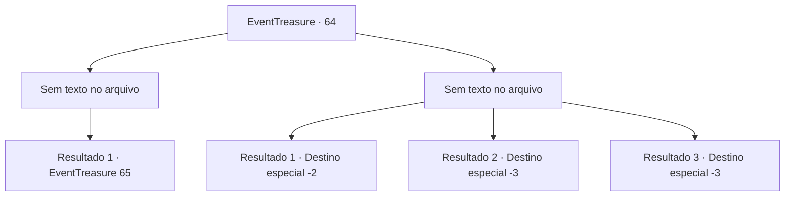

# Eventos de tesouro · 64

[Índice da tabela](index.md) · [Índice geral](../index.md)

ID: `pt:EventTreasure:64` · Fonte: `EventTreasure4` · Versão: 1.2.47.

Mapeamento estático dos arquivos; a disponibilidade e a execução dependem do estado da run.

## Texto do evento

*Sem texto no arquivo.*

## Dados de entrada

```json
{
  "id": 64,
  "grade": 1,
  "place": "",
  "required": ""
}
```

## Mapa das escolhas



## Escolhas e resultados

### Escolha 1

*Sem texto no arquivo; o papel dessa opção depende da interface do jogo.*

Requisitos e outros campos da escolha:

```json
{
  "required": ""
}
```

#### Resultado 1.1

Você derrota a gargula. Contudo, a premonição continua. Você pisa numa parte da gargula destroçada, deixando o portão para trás. 

 Após andar por sabe-se lá quanto tempo, você encontra um homem sentado num toco de árvore. Ele murmurava uma canção, e então ele te avista, ele te encara com um olhar surpreso. 

 "Eu não achei que encontraria alguém numa floresta tão densa. Você não é um lenhador, é?"

 Ele provavelmente está preocupado, achando que você vai pegar a árvore dele.

Continuação registrada: [Evento 65](0065.md) na mesma tabela.

```json
{
  "required": "",
  "chance": "1",
  "nextEvent": 65,
  "type": 2,
  "reward": ""
}
```

### Escolha 2

*Sem texto no arquivo; o papel dessa opção depende da interface do jogo.*

Requisitos e outros campos da escolha:

```json
{
  "required": ""
}
```

#### Resultado 2.1

Você perde para a gargula e é chutado para fora do portão. Ele mantém os olhos em você enquanto você está fugindo, mas não mais te segue.

Continuação registrada: [Destino especial `-2`](../destinos-especiais.md).

```json
{
  "required": "1_1_2|1_0_2",
  "chance": "1",
  "nextEvent": -2,
  "type": 2,
  "reward": "0_0_-1|0_1_-1|5_107_9"
}
```

#### Resultado 2.2

Você é morto pela gargula.

Continuação registrada: [Destino especial `-3`](../destinos-especiais.md).

```json
{
  "required": "2_0_2",
  "chance": "1",
  "nextEvent": -3,
  "type": 2,
  "reward": "0_0_-1|0_1_-1"
}
```

#### Resultado 2.3

Você é morto pela gargula.

Continuação registrada: [Destino especial `-3`](../destinos-especiais.md).

```json
{
  "required": "2_1_2",
  "chance": "1",
  "nextEvent": -3,
  "type": 2,
  "reward": "0_0_-1|0_1_-1"
}
```

## Referências que chegam a este evento

- [Evento 63 · escolha 1 · resultado 1](0063.md#escolha-1)
