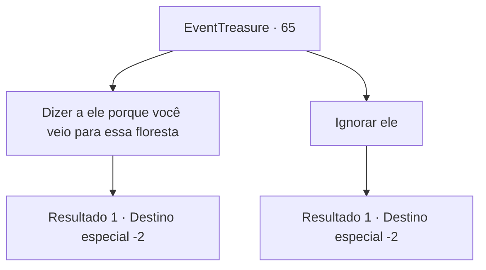

# Eventos de tesouro · 65

[Índice da tabela](index.md) · [Índice geral](../index.md)

ID: `pt:EventTreasure:65` · Fonte: `EventTreasure4` · Versão: 1.2.47.

Mapeamento estático dos arquivos; a disponibilidade e a execução dependem do estado da run.

## Texto do evento

*Sem texto no arquivo.*

## Dados de entrada

```json
{
  "id": 65,
  "grade": 1,
  "place": "",
  "required": ""
}
```

## Mapa das escolhas



## Escolhas e resultados

### Escolha 1

Dizer a ele porque você veio para essa floresta

Requisitos e outros campos da escolha:

```json
{
  "required": ""
}
```

#### Resultado 1.1

Você o conta o porque de ter vindo à floresta. Ele olha o mapa, parece perturbado por um tempo, e abre a boca. 

 "Hmm... pelo jeito... é um lugar chamado Salão do antigo herói 'Per-Sheryuse'. Eu não iria lá se eu fosse você, mas eu duvido que você vá me ouvir. Um conselho... aparentemente há um imenso porteiro, você deve olhá-lo nos olhos. Embora, seja só um rumor que eu ouvi em algum lugar."

 Você pega o conselho e segue para o destino.

Continuação registrada: [Destino especial `-2`](../destinos-especiais.md).

```json
{
  "required": "",
  "chance": "1",
  "nextEvent": -2,
  "type": 2,
  "reward": "5_107_2|5_109_1"
}
```

### Escolha 2

Ignorar ele

Requisitos e outros campos da escolha:

```json
{
  "required": ""
}
```

#### Resultado 2.1

Você o ignora e se apressa em direção ao seu destino. Ele parece aliviado que você não está lá para cortar lenha.

Continuação registrada: [Destino especial `-2`](../destinos-especiais.md).

```json
{
  "required": "",
  "chance": "1",
  "nextEvent": -2,
  "type": 2,
  "reward": "5_107_2"
}
```

## Referências que chegam a este evento

- [Evento 64 · escolha 1 · resultado 1](0064.md#escolha-1)
