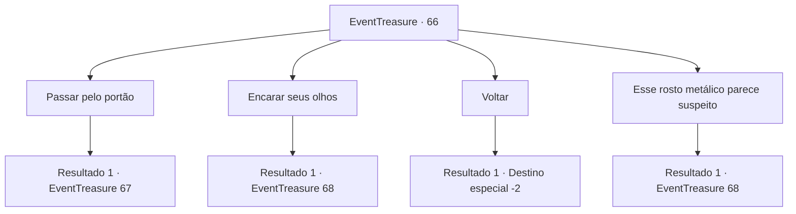

# Eventos de tesouro · 66

[Índice da tabela](index.md) · [Índice geral](../index.md)

ID: `pt:EventTreasure:66` · Fonte: `EventTreasure4` · Versão: 1.2.47.

Mapeamento estático dos arquivos; a disponibilidade e a execução dependem do estado da run.

## Texto do evento

Você chega ao destino desenhado no mapa antigo. Era um prédio imenso construído no topo de uma montanha, com traços da passagem do tempo  todo ele. Na entrada para o salão de Per-Sheryus, está o portão que você viu antes, com um rosto de aço no chão.

## Dados de entrada

```json
{
  "id": 66,
  "grade": 2,
  "place": "",
  "required": "5_107_2|1_2_55"
}
```

## Mapa das escolhas



## Escolhas e resultados

### Escolha 1

Passar pelo portão

Requisitos e outros campos da escolha:

```json
{
  "required": ""
}
```

#### Resultado 1.1

Você tenta passar pelo portão. Contudo, o chão treme de repente, e um golem feito de aço se levanta. Parece que o rosto metálico no chão pertencia a esse golem. O golem não diz nada, e procede a arremessar o punho em sua direção.

Continuação registrada: [Evento 67](0067.md) na mesma tabela.

```json
{
  "required": "",
  "chance": "1",
  "nextEvent": 67,
  "type": 2,
  "reward": "6_0_43",
  "place": 1
}
```

### Escolha 2

Encarar seus olhos

Requisitos e outros campos da escolha:

```json
{
  "required": "5_109_1"
}
```

#### Resultado 2.1

Como o lenhador na mata disse, você encara os olhos do rosto metálico. Então a boca dele se mexe e faz um som. 

 "Você recebe permissão para entrar."

 Com isso, o rosto metálico se cala. Você passa pelo portão, rumo ao salão. |drawing_hallOfperseryuse| Dentro do salão parece uma zona de guerra, com colunas destroçadas e armas enferrujadas espalhados por toda parte. No fim da alta escadaria, há uma estátua de bronze de uma deusa e um trono de mármore. Enquanto sobe as escadas, alguém sai de um lugar que definitivamente estava vazio. Ele está calçando sandálias aladas, e segura uma espada com uma lâmina curvada, e um escudo de bronze. 

 "Argh... prazer te conhecer. Eu estava morrendo de tédio, e um novo amigo aparece. O que você está fazendo? Saque sua arma."


Continuação registrada: [Evento 68](0068.md) na mesma tabela.

```json
{
  "required": "",
  "chance": "1",
  "nextEvent": 68,
  "type": 2,
  "reward": ""
}
```

### Escolha 3

Voltar

Requisitos e outros campos da escolha:

```json
{
  "required": ""
}
```

#### Resultado 3.1

Você repentinamente se sente sinistro, e dá meia volta.

Continuação registrada: [Destino especial `-2`](../destinos-especiais.md).

```json
{
  "required": "",
  "chance": "1",
  "nextEvent": -2,
  "type": 2,
  "reward": "5_107_9"
}
```

### Escolha 4

Esse rosto metálico parece suspeito

Requisitos e outros campos da escolha:

```json
{
  "required": "1_14_12"
}
```

#### Resultado 4.1

Você desconfia do rosto metálico e o encara. Então a boca dele se mexe e faz um som. 

 "Você recebe permissão para entrar."

 Com isso, o rosto metálico se cala. Você passa pelo portão, rumo ao salão. |drawing_hallOfperseryuse| Dentro do salão parece uma zona de guerra, com colunas destroçadas e armas enferrujadas espalhados por toda parte. No fim da alta escadaria, há uma estátua de bronze de uma deusa e um trono de mármore. Enquanto sobe as escadas, alguém sai de um lugar que definitivamente estava vazio. Ele está calçando sandálias aladas, e segura uma espada com uma lâmina curvada, e um escudo de bronze. 

 "Argh... prazer te conhecer. Eu estava morrendo de tédio, e um novo amigo aparece. O que você está fazendo? Saque sua arma."


Continuação registrada: [Evento 68](0068.md) na mesma tabela.

```json
{
  "required": "",
  "chance": "1",
  "nextEvent": 68,
  "type": 2,
  "reward": ""
}
```

## Referências que chegam a este evento

Nenhum `nextEvent` positivo da mesma tabela aponta para este nó. Isso não prova que seja inacessível: sorteio e estado de história podem selecioná-lo.

